# Pemkot-AI: Rencana Demo Asisten AI untuk Pengelolaan Vendor dan Proyek Pemerintah Kota

> **Versi 2.** Dokumen perencanaan untuk **demo kedua**. Polanya sama dengan Halvi (website chat AI, Next.js + Supabase + Gemini), tetapi fokusnya diganti: **mengurus vendor penyedia barang dan jasa, mengecek vendor mana yang ready mengerjakan sebuah proyek, dan mengarahkan vendor ke proyek yang sedang ada**.
>
> **Status:** perencanaan. Belum ada kode. Semua data dalam demo **fiktif**.
> Semua diagram memakai [Mermaid](https://mermaid.js.org/) dan tampil otomatis di GitHub atau editor yang mendukungnya.
>
> Versi 1 (fokus stok dan gudang) disimpan di `arsip/pemkot-AI-v1-stok.md`.

## Daftar isi
1. [Ringkasan dan tujuan demo](#1-ringkasan-dan-tujuan-demo)
2. [Ruang lingkup fitur](#2-ruang-lingkup-fitur)
3. [Peran dan hak akses](#3-peran-dan-hak-akses)
4. [Workflow per modul](#4-workflow-per-modul)
5. [Mesin ketersediaan dan rekomendasi](#5-mesin-ketersediaan-dan-rekomendasi)
6. [Flowchart](#6-flowchart)
7. [Desain AI agentic](#7-desain-ai-agentic)
8. [Database](#8-database)
9. [ERD](#9-erd)
10. [Class diagram dan state diagram](#10-class-diagram-dan-state-diagram)
11. [Tech stack dan alat](#11-tech-stack-dan-alat)
12. [Struktur proyek](#12-struktur-proyek)
    - [12A. Desain dan tampilan](#12a-desain-dan-tampilan)
13. [Infrastruktur dan persiapan](#13-infrastruktur-dan-persiapan)
14. [Data contoh (seed)](#14-data-contoh-seed)
15. [Keamanan, privasi, dan risiko](#15-keamanan-privasi-dan-risiko)
16. [Rencana kerja bertahap](#16-rencana-kerja-bertahap)
17. [Pengujian dan kriteria selesai](#17-pengujian-dan-kriteria-selesai)
18. [Skrip demo](#18-skrip-demo)
19. [Pertanyaan terbuka untuk atasan](#19-pertanyaan-terbuka-untuk-atasan)
20. [Glosarium](#20-glosarium)

---

## 1. Ringkasan dan tujuan demo

### Apa yang dibangun
Sebuah website dengan **chat AI** untuk pegawai pemerintah kota dan vendor. Pengguna bertanya dengan bahasa sehari-hari. AI mencari data di database, menampilkan hasilnya dalam kartu yang rapi, lalu memberi **rekomendasi vendor** untuk sebuah proyek. Bila diminta, AI membuatkan file Excel atau PowerPoint.

### Tiga permintaan atasan
| # | Permintaan | Artinya di sistem |
|---|---|---|
| 1 | Mengurus barang dan jasa vendor | Pendaftaran vendor, katalog barang dan jasa yang ditawarkan, sertifikat, kapasitas, status |
| 2 | Mengecek siapa saja yang ready mengerjakan proyek | Mesin ketersediaan: syarat wajib dan skor kecocokan |
| 3 | Mengecek proyek yang ada dan vendor yang bisa diarahkan | Daftar proyek, rekomendasi vendor, usulan penugasan, persetujuan |

### Cara kerja dalam satu gambar
Tiga hal utama: **Vendor**, **Proyek**, dan **Penugasan**. AI membantu mencocokkan ketiganya, manusia yang memutuskan.

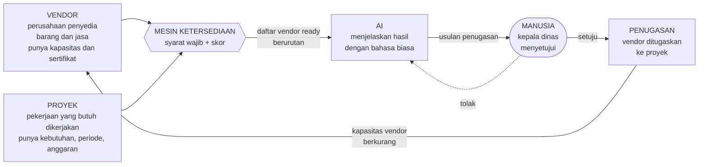

Contoh kalimat pengguna:
- "Proyek apa saja yang sedang berjalan dan belum punya vendor?"
- "Siapa yang ready untuk renovasi gedung dinas bulan Januari sampai Maret?"
- "Kenapa PT Karya Bangun direkomendasikan paling atas?"
- "Tugaskan vendor itu ke proyek tersebut."
- "Vendor mana yang punya layanan pengadaan alat kesehatan dan sertifikatnya masih berlaku?"
- "Buatkan daftar rekomendasi vendor dalam Excel dan ringkasannya dalam 5 slide PowerPoint."

### Hubungan dengan Halvi
| Halvi (demo pertama) | Pemkot-AI (demo kedua) |
|---|---|
| Menjawab soal kelas dan harga | Menjawab soal vendor, proyek, ketersediaan, penugasan |
| Pengunjung anonim dan satu admin | Beberapa **peran** dengan hak akses berbeda |
| Tool: cari program, daftar kelas, buat invoice | Tool: cari vendor, cek ketersediaan, rekomendasi, usulan penugasan, buat Excel dan PPT |
| Admin memverifikasi bukti bayar | Kepala dinas **menyetujui** penugasan dan vendor baru |
| Kursi kelas dipesan atomik (`book_seat()`) | Kapasitas vendor dicek ulang atomik saat persetujuan |
| Gemini dengan rantai model cadangan | Gemini utama, **Groq sebagai cadangan** |

### Yang didemokan
1. Pengelolaan vendor: pendaftaran, katalog barang dan jasa, sertifikat, status.
2. Daftar proyek dan kebutuhannya.
3. Pengecekan **vendor yang ready** untuk satu proyek, lengkap dengan alasan dan rincian skor.
4. Usulan penugasan yang menunggu persetujuan, lalu diterapkan setelah disetujui.
5. AI membuat dokumen kerja (Excel, PowerPoint) dari data nyata di database.
6. Semua aksi yang mengubah data tercatat di audit log.

### Di luar cakupan demo
- Stok barang, gudang, dan pesanan barang (PO). Semua itu **tidak** termasuk.
- Integrasi sungguhan dengan e-katalog LKPP, SIRUP, SPSE, atau sistem keuangan daerah.
- Data pemerintah asli.
- Tender, kontrak resmi, tanda tangan digital, dan pembayaran.
- Aplikasi mobile native (cukup website responsif).

### Kriteria demo berhasil
- Empat peran bisa login dan masing-masing hanya melihat yang boleh dilihat.
- Untuk satu proyek, daftar vendor ready **sama persis** dengan hasil hitungan database, termasuk rincian skornya.
- Vendor yang penuh, tidak aktif, tidak tersedia, atau sertifikatnya kedaluwarsa **tidak** muncul sebagai ready.
- Penugasan tidak terjadi sebelum disetujui, dan dua penugasan bersamaan tidak membuat vendor melewati kapasitas.
- File Excel dan PowerPoint buatan AI bisa dibuka dan isinya cocok dengan data.
- Jika Gemini kehabisan kuota, chat tetap jalan lewat Groq.

---

## 2. Ruang lingkup fitur

| # | Modul | Contoh pertanyaan | Tool utama | Jenis |
|---|---|---|---|---|
| 1 | Vendor dan katalog | "Cari vendor jasa kebersihan yang aktif." | `cari_vendor`, `cek_vendor` | Baca |
| 2 | Pendaftaran vendor | "Saya ingin mendaftarkan usaha saya." | `daftar_vendor` | Usul tulis |
| 3 | Proyek | "Proyek apa yang belum punya vendor?" | `daftar_proyek`, `detail_proyek` | Baca |
| 4 | Ketersediaan | "Apakah CV Maju Jaya bisa dipakai bulan Februari?" | `cek_ketersediaan_vendor` | Baca |
| 5 | Rekomendasi | "Vendor mana yang paling cocok untuk renovasi gedung dinas?" | `rekomendasikan_vendor` | Baca (dihitung database) |
| 6 | Penugasan | "Tugaskan PT Karya Bangun ke proyek itu." | `ajukan_penugasan` | Usul tulis |
| 7 | Agen dokumen | "Buatkan daftar rekomendasi dalam Excel dan ringkasan PPT." | `buat_excel`, `buat_powerpoint`, `ringkas_data` | Menulis file |

Keterangan jenis:
- **Baca:** hanya membaca database.
- **Usul tulis:** AI tidak mengubah data langsung. AI membuat **usulan** yang menunggu persetujuan (bagian 7).
- **Menulis file:** membuat berkas di penyimpanan privat, bukan mengubah data bisnis.

Halaman pendukung di luar chat, supaya demo terlihat seperti aplikasi utuh: dashboard ringkasan per peran, daftar vendor dan proyek (tabel sederhana), halaman persetujuan, dan daftar berkas buatan AI.

---

## 3. Peran dan hak akses

Demo memakai **empat akun contoh**. Menu, halaman, dan tool AI menyesuaikan peran.

| Peran | Deskripsi | Boleh |
|---|---|---|
| `admin_pengadaan` | Staf unit pengadaan | Semua pencarian, rekomendasi, usulan penugasan, mendaftarkan vendor, membuat dokumen |
| `pic_proyek` | Penanggung jawab proyek di satu dinas | Melihat proyek dinasnya, meminta rekomendasi, mengusulkan penugasan untuk proyeknya |
| `kepala_dinas` | Pejabat pengambil keputusan | Melihat semua, **menyetujui atau menolak** usulan, membuat Excel dan PPT |
| `vendor` | Penyedia dari luar | Hanya data vendornya sendiri, pendaftaran, katalog, kapasitas, dan penugasan miliknya |

### Matriks peran dan tool

| Tool | admin_pengadaan | pic_proyek | kepala_dinas | vendor |
|---|:---:|:---:|:---:|:---:|
| `cari_vendor` | ✅ | ✅ | ✅ | — |
| `cek_vendor` | ✅ | ✅ | ✅ | ✅ (dirinya) |
| `cek_ketersediaan_vendor` | ✅ | ✅ | ✅ | ✅ (dirinya) |
| `daftar_proyek` | ✅ | ✅ (dinasnya) | ✅ | ✅ (penugasannya) |
| `detail_proyek` | ✅ | ✅ (dinasnya) | ✅ | ✅ (penugasannya) |
| `rekomendasikan_vendor` | ✅ | ✅ (dinasnya) | ✅ | — |
| `ajukan_penugasan` | ✅ | ✅ (dinasnya) | — | — |
| `daftar_vendor` | ✅ (atas nama vendor) | — | — | ✅ |
| `buat_excel` | ✅ | ✅ | ✅ | — |
| `buat_powerpoint` | ✅ | — | ✅ | — |
| `ringkas_data` | ✅ | ✅ | ✅ | — |
| Menyetujui usulan | — | — | ✅ | — |

### Aturan penerapan
1. Tool **dibangun per request** sesuai peran (pola yang sama dengan `ownerId` di Halvi). Tool yang tidak boleh dipakai peran itu **tidak ikut dikirim ke model**, jadi model tidak bisa memanggilnya.
2. Peran dibaca di server dari tabel `profiles`, bukan dari kiriman browser.
3. Pembatasan kedua ada di **database** lewat Row Level Security (RLS), sebagai lapis pengaman jika kode tool salah.
4. Setiap pemanggilan tool tulis dicatat di `audit_logs`.

---

## 4. Workflow per modul

### 4.1 Cari dan cek vendor
1. Pengguna menyebut kebutuhan ("vendor jasa kebersihan yang aktif di Kota ini").
2. AI memanggil `cari_vendor` dengan kata kunci, kategori, tipe (barang atau jasa), dan wilayah.
3. Server mencari di `vendors` dan `vendor_services` (kemiripan teks), lalu menampilkan **kartu vendor**: nama, status, kategori layanan, kisaran harga, sertifikat yang berlaku, kapasitas, dan penilaian rata-rata.
4. `cek_vendor` menampilkan profil lengkap satu vendor: dokumen, riwayat penugasan, penilaian, dan tanda peringatan (sertifikat hampir habis, status daftar hitam).

### 4.2 Pendaftaran vendor
1. Vendor (atau admin atas nama vendor) dapat mengisi form di chat. Admin Pengadaan juga dapat menambah vendor dari halaman Vendor. Pendaftaran baru disimpan sebagai `draft`; data draft dapat dilengkapi dari halaman detail vendor.
2. Vendor menambahkan katalog layanan: jenis barang atau jasa, kisaran harga, satuan.
3. Vendor mengunggah dokumen dan sertifikat (NIB, NPWP, akta, SBU, K3, dan lain-lain). AI membaca dokumen dengan vision untuk memeriksa kelengkapan dan kecocokan data (pola seperti pemeriksa bukti bayar di Halvi).
4. Status vendor menjadi `verifikasi`. Admin memeriksa, lalu mengusulkan aktivasi. Kepala dinas menyetujui.
5. Status menjadi `aktif`, dan vendor ikut dihitung dalam pencarian ready.

Admin Pengadaan dapat mengusulkan perubahan data vendor aktif atau pengarsipan dari daftar Vendor. Data tidak berubah sebelum Kepala Dinas menyetujui. Vendor yang memiliki usulan atau penugasan aktif belum dapat diarsipkan.

### 4.3 Lihat proyek yang ada
1. Pengguna bertanya ("proyek apa yang sedang ada?", "yang belum punya vendor?").
2. `daftar_proyek` menampilkan proyek sesuai peran dan filter (status, dinas, periode).
3. `detail_proyek` menampilkan kebutuhan: kategori layanan, tenaga minimal, sertifikat wajib, periode, anggaran, wilayah, dan vendor yang sudah ditugaskan.

### 4.4 Cek siapa yang ready dan rekomendasi
1. Pengguna meminta rekomendasi untuk satu proyek, atau mengecek satu vendor pada periode tertentu.
2. `rekomendasikan_vendor` memanggil fungsi database `cari_vendor_ready()` (bagian 5). Hasilnya adalah daftar vendor yang lolos semua syarat wajib, **berurutan menurut skor**, lengkap dengan rincian per komponen.
3. Kartu rekomendasi menampilkan: peringkat, skor, rincian skor, sisa kapasitas, dan syarat yang terpenuhi.
4. AI menjelaskan dengan bahasa biasa **berdasarkan angka dari database**, misalnya "PT A paling atas karena pengalamannya paling banyak dan masih punya dua slot kosong".
5. Untuk satu vendor, `cek_ketersediaan_vendor` menjawab "bisa atau tidak pada periode ini", beserta alasannya.

### 4.5 Usulan penugasan dan persetujuan
1. Pengguna memilih vendor dari rekomendasi dan meminta penugasan.
2. Tool `ajukan_penugasan` hanya menyiapkan kartu pratinjau. Setelah pengguna mengonfirmasi kartu, server memvalidasi ulang akses, status ready, kapasitas, dan periode, lalu membuat baris `project_assignments` berstatus `diusulkan` dan usulan di `approvals` berstatus `pending`. **Belum ada kapasitas yang berkurang.**
3. Kartu konfirmasi tampil sebelum usulan dibuat. Setelah berhasil, status "Menunggu persetujuan" tampil untuk pengusul dan usulan muncul di halaman **Persetujuan** kepala dinas.
4. Jika **disetujui**, fungsi database `apply_approval()` mengunci baris vendor, **mengecek ulang kapasitas**, lalu mengubah penugasan menjadi `disetujui`. Jika kapasitas ternyata sudah habis (karena ada penugasan lain yang disetujui lebih dulu), persetujuan gagal dengan alasan yang jelas.
5. Jika **ditolak**, usulan ditutup dan alasannya disimpan.
6. Pengusul diberi tahu hasilnya di chat. Semua tercatat di `audit_logs`.

### 4.6 Agen dokumen (Excel, PowerPoint, kerja bantu)
1. Pengguna memberi tugas besar: "buatkan daftar rekomendasi vendor untuk proyek X dalam Excel dan ringkasan 5 slide".
2. AI merencanakan langkah: ambil detail proyek, ambil rekomendasi, buat Excel, ringkas temuan, buat PowerPoint.
3. Berkas disimpan di penyimpanan privat dan diberikan sebagai tautan unduh yang kedaluwarsa.
4. Chat menampilkan kartu berkas: nama, jenis, jumlah baris atau slide, dan tombol unduh.
5. Semua angka di dokumen berasal dari database, bukan dari ingatan AI.

---

## 5. Mesin ketersediaan dan rekomendasi

Ini bagian paling penting dari demo. Aturannya **ditulis di database**, bukan di dalam jawaban AI, supaya hasilnya konsisten, bisa dijelaskan, dan bisa diuji.

### 5.1 Dua tahap
1. **Syarat wajib (filter).** Vendor yang gagal satu saja langsung gugur.
2. **Skor kecocokan (urutan).** Vendor yang lolos diberi nilai 0 sampai 100, lalu diurutkan.

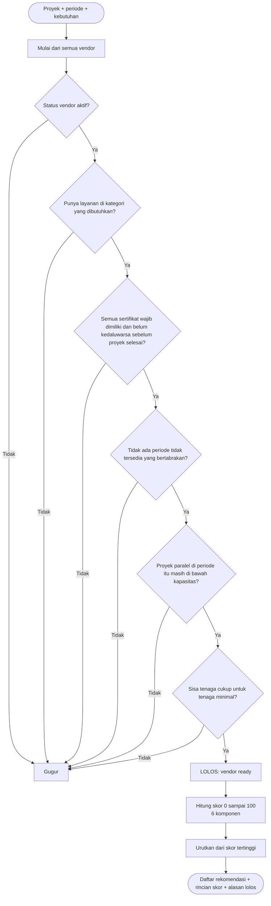

### 5.2 Syarat wajib
| # | Syarat | Dibaca dari |
|---|---|---|
| 1 | Status vendor `aktif` (bukan draft, verifikasi, ditolak, atau daftar hitam) | `vendors.status` |
| 2 | Punya layanan pada kategori yang dibutuhkan proyek | `vendor_services`, `project_requirements` |
| 3 | Punya semua sertifikat wajib, dan belum kedaluwarsa pada tanggal selesai proyek | `vendor_certifications`, `project_requirements.sertifikat_wajib` |
| 4 | Tidak ada periode tidak tersedia yang bertabrakan dengan periode proyek | `vendor_unavailability` |
| 5 | Jumlah proyek paralel pada periode itu lebih kecil dari `kapasitas_proyek` | `project_assignments`, `vendors.kapasitas_proyek` |
| 6 | Sisa tenaga (`total_tenaga` dikurangi tenaga yang sudah dialokasikan pada periode itu) cukup untuk `tenaga_min` | `project_assignments`, `vendors.total_tenaga` |

Yang dihitung sebagai "memakai kapasitas": penugasan berstatus `disetujui` atau `berjalan` yang periodenya bertabrakan. Usulan (`diusulkan`) **belum** memakai kapasitas.

### 5.3 Skor kecocokan (usulan awal, bobot bisa diubah)
| Komponen | Bobot | Cara menghitung |
|---|---:|---|
| Pengalaman serupa | 25 | Jumlah proyek selesai di kategori yang sama, dibatasi 5 (5 atau lebih = nilai penuh) |
| Penilaian kinerja | 25 | Rata-rata skor kualitas dari `vendor_ratings` (skala 1 sampai 5) |
| Ketepatan waktu | 15 | Persentase proyek selesai tepat waktu |
| Sisa kapasitas | 15 | Makin longgar (proyek paralel makin sedikit dibanding kapasitas), makin tinggi |
| Kecocokan harga | 10 | Kisaran harga layanan sesuai anggaran proyek |
| Wilayah | 10 | Wilayah layanan vendor mencakup lokasi proyek |

Aturan skor:
- Vendor baru tanpa riwayat tidak dihukum berlebihan: pengalaman 5 dari 25 (setara satu proyek selesai), kinerja 3 dari 5, dan ketepatan waktu 60 persen, lalu **ditandai "belum ada riwayat"** di kartu.
- Jika proyek punya beberapa kebutuhan, vendor harus memenuhi semua kategori dan semua sertifikat, dan tenaga yang dibutuhkan adalah jumlah seluruh kebutuhan.
- Vendor yang sudah diusulkan atau ditugaskan pada proyek yang sama tidak masuk daftar ready.
- Rincian per komponen selalu ditampilkan. Tidak ada kriteria tersembunyi.
- Bobot adalah **keputusan kebijakan**, bukan keputusan teknis. Nilai awal di atas adalah usulan untuk demo dan perlu disetujui atasan (bagian 19).

### 5.4 Prinsip
1. **Angka dihitung di database. AI hanya menjelaskan.** Model tidak boleh menghitung skor atau mengurutkan sendiri.
2. **Hasil harus bisa dijelaskan.** Tiap vendor membawa rincian skor dan daftar syarat yang lolos.
3. **Manusia memutuskan.** Rekomendasi bukan keputusan. Penugasan baru berlaku setelah disetujui.
4. **Tidak ada penugasan ganda.** Kapasitas dicek ulang secara atomik saat persetujuan.

### 5.5 Contoh hasil (fiktif)
Proyek "Renovasi Gedung Dinas", kebutuhan jasa konstruksi, tenaga minimal 15, sertifikat wajib SBU dan K3, periode 3 bulan.

| Peringkat | Vendor | Skor | Pengalaman | Kinerja | Waktu | Kapasitas | Harga | Wilayah | Sisa kapasitas |
|---:|---|---:|---:|---:|---:|---:|---:|---:|---|
| 1 | PT Karya Bangun | 86 | 25 | 22 | 13 | 10 | 10 | 6 | 2 dari 4 proyek |
| 2 | CV Teknik Mandiri | 79 | 20 | 21 | 12 | 15 | 5 | 6 | 3 dari 3 proyek |
| 3 | PT Bangun Sejahtera | 71 | 15 | 18 | 12 | 10 | 10 | 6 | 1 dari 2 proyek |

Tidak muncul, dengan alasan yang bisa ditampilkan jika ditanya: CV Maju Konstruksi (kapasitas penuh), PT Griya Utama (sertifikat K3 kedaluwarsa), CV Anugerah (tidak tersedia periode itu).

---

## 6. Flowchart

### 6.1 Gambaran sistem

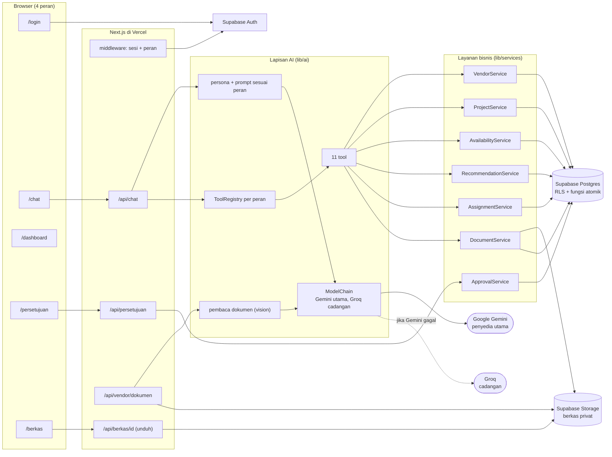

### 6.2 Peta halaman

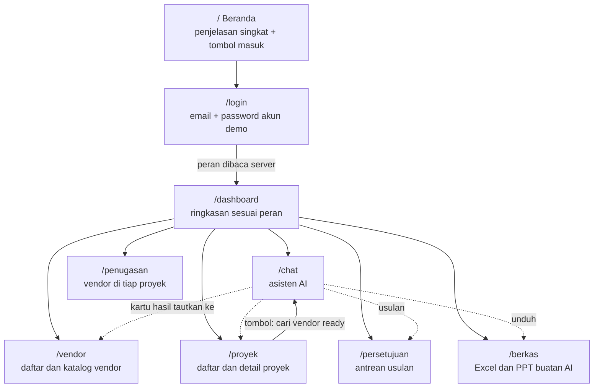

### 6.3 Alur chat dan pemilihan tool

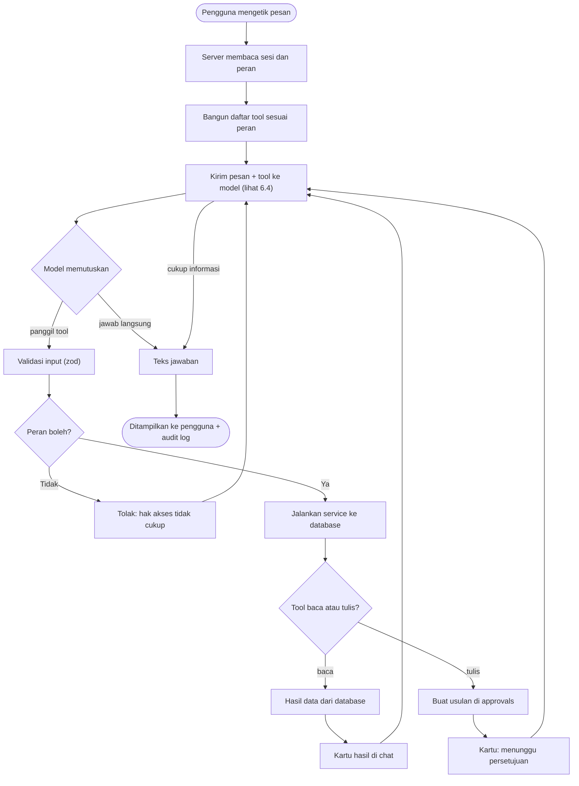

### 6.4 Pemilihan model dan cadangan (Gemini utama, Groq cadangan)

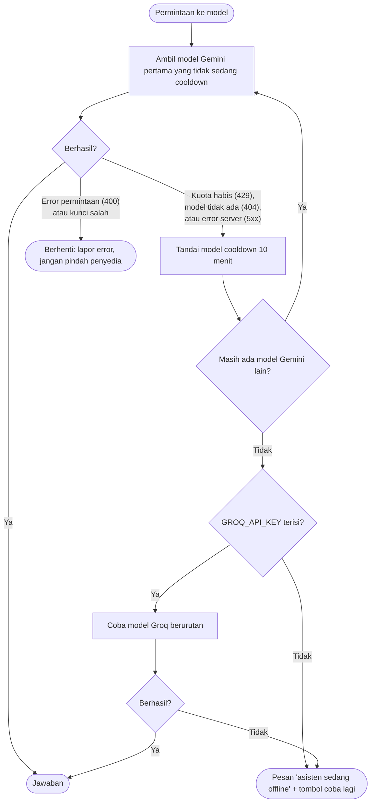

Aturan:
- Gemini selalu dicoba lebih dulu. Groq **hanya** dipakai jika seluruh model Gemini gagal karena kuota, tidak tersedia, atau error server.
- Perpindahan tidak terlihat oleh pengguna. Riwayat percakapan dikirim ulang apa adanya, jadi tidak perlu "memindahkan sesi".
- Log server mencatat model mana yang akhirnya dipakai, untuk pemantauan.

### 6.5 Alur rekomendasi dan penugasan

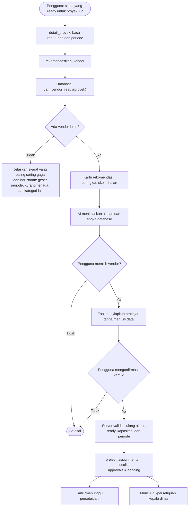

### 6.6 Alur persetujuan

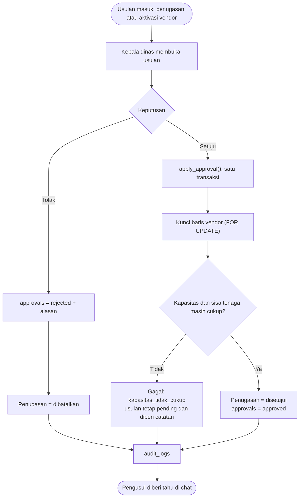

### 6.7 Pendaftaran vendor

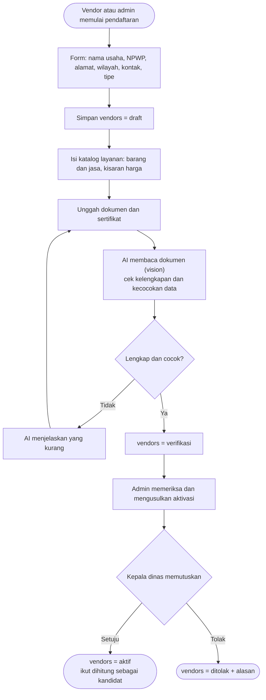

### 6.8 Diagram urutan: rekomendasi lalu membuat Excel dan PPT

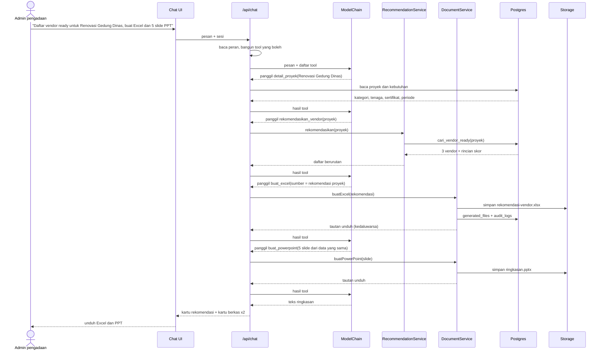

### 6.9 Diagram urutan: dua usulan penugasan bersamaan

Contoh yang menunjukkan kenapa kapasitas dicek ulang saat persetujuan. Vendor X hanya punya satu slot kosong.

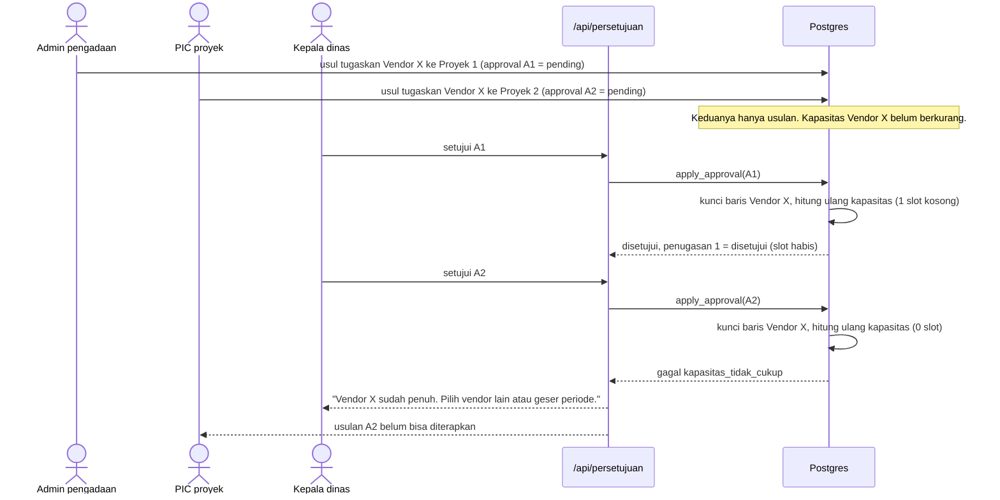

---

## 7. Desain AI agentic

### 7.1 Prinsip
1. **Data dari database, bukan dari model.** Angka (skor, kapasitas, harga, tanggal) selalu berasal dari hasil tool. Model hanya memilih tool dan merangkai kalimat.
2. **Usul, konfirmasi, jalankan.** Tool yang mengubah data tidak mengubah apa pun. Tool itu hanya membuat usulan. Manusia yang menyetujui.
3. **Hak akses di tiga tempat:** daftar tool per peran, validasi di service, dan RLS di database.
4. **Semua tercatat.** Setiap panggilan tool tulis dan setiap persetujuan masuk `audit_logs`.
5. **Dokumen dari pengguna dianggap data, bukan perintah.** Teks di dalam PDF atau gambar vendor tidak boleh menyuruh AI melakukan sesuatu (perlindungan prompt injection).
6. **Rekomendasi transparan.** Model tidak boleh mengubah urutan atau skor dari database, dan tidak boleh menambahkan alasan yang tidak ada di data.

### 7.2 Daftar tool

| Tool | Input utama | Output | Jenis | Peran |
|---|---|---|---|---|
| `cari_vendor` | `kata_kunci?`, `kategori?`, `tipe?`, `wilayah?`, `status?` | daftar vendor + ringkasan layanan, sertifikat, kapasitas | Baca | admin, pic, kepala |
| `cek_vendor` | `nama` atau `npwp` | profil, dokumen, riwayat penugasan, penilaian, peringatan | Baca | admin, pic, kepala, vendor (dirinya) |
| `cek_ketersediaan_vendor` | `vendor`, `mulai`, `selesai`, `tenaga?` | bisa atau tidak, sisa slot dan tenaga, alasan jika tidak | Baca | admin, pic, kepala, vendor (dirinya) |
| `daftar_proyek` | `status?`, `dinas?`, `periode?`, `tanpa_vendor?` | daftar proyek | Baca | admin, pic (dinasnya), kepala, vendor (penugasannya) |
| `detail_proyek` | `proyek` | kebutuhan, periode, anggaran, vendor yang ditugaskan | Baca | admin, pic (dinasnya), kepala, vendor (penugasannya) |
| `rekomendasikan_vendor` | `proyek`, `jumlah?` | peringkat, skor, rincian, alasan lolos dan gugur | Baca | admin, pic (dinasnya), kepala |
| `ajukan_penugasan` | `proyek`, `vendor`, `tenaga`, `mulai`, `selesai`, `alasan` | kartu pratinjau saja; usulan dan penugasan `diusulkan` dibuat setelah konfirmasi eksplisit pengguna | Pratinjau, lalu usul tulis | admin, pic (dinasnya) |
| `daftar_vendor` | isian awal data usaha (opsional) | membuka form di chat. Tool tidak menyimpan apa pun. Setelah pengguna mengirim form, server menyimpan vendor `draft`. Unggah dokumen menyusul | Usul tulis | vendor, admin |
| `buat_excel` | `judul`, `sumber` (nama query bawaan) atau `kolom[]` dan `baris[]` | berkas `.xlsx` + tautan | Menulis file | admin, pic, kepala |
| `buat_powerpoint` | `judul`, `slide[]` atau `sumber` | berkas `.pptx` + tautan | Menulis file | admin, kepala |
| `ringkas_data` | `sumber` atau data hasil tool lain | ringkasan teks dan poin utama | Baca | admin, pic, kepala |

Catatan: `buat_excel` dan `buat_powerpoint` sebaiknya menerima **nama sumber data bawaan** (misalnya `rekomendasi_proyek`, `proyek_tanpa_vendor`, `vendor_sertifikat_hampir_habis`) dan mengambil datanya sendiri di server. Dengan begitu model tidak perlu menyalin banyak baris (hemat token dan tidak ada salah salin).

### 7.3 Pola usulan dan persetujuan
- Tabel `approvals` menyimpan jenis aksi (`project_assignment`, `vendor_activation`, `vendor_update`, `vendor_archive`), data aksi (`payload` JSON), pengusul, status, pemutus, dan catatan.
- Perubahan data yang diminta dari antarmuka harus melewati dialog konfirmasi yang jelas. Membatalkan dialog tidak menjalankan perubahan. Untuk usulan chat, tool hanya menyiapkan pratinjau; endpoint server memeriksa ulang hak akses dan data sebelum membuat usulan.
- Draft vendor dapat disimpan langsung sebagai draft. Perubahan data vendor aktif dan permintaan arsip hanya membuat usulan; fungsi `apply_approval()` menerapkan perubahan setelah Kepala Dinas menyetujui.
- Fungsi `apply_approval()` membaca payload lalu menjalankan perubahan dalam **satu transaksi**. Untuk penugasan, fungsi mengunci baris vendor dan **mengecek ulang kapasitas dan tenaga** sebelum menyetujui. Pengarsipan juga menolak vendor yang masih memiliki usulan atau penugasan aktif (bagian 8.5).
- Kartu di chat: Menunggu, Disetujui, Ditolak, Gagal (dengan alasan).

### 7.4 Loop agen
- Memakai `streamText` dengan `stopWhen: isStepCount(N)`. Halvi memakai 6 langkah. Untuk agen dokumen disarankan **10 sampai 12**, karena satu tugas bisa butuh ambil proyek, rekomendasi, buat Excel, ringkas, buat PPT.
- Setiap tool mengembalikan hasil **ringkas dan terstruktur** (bukan ribuan baris) supaya konteks tidak penuh.
- Jika tool gagal, hasilnya berupa pesan error yang bisa dipahami model, lalu model memberi tahu pengguna dengan sopan. Tidak ada percobaan berulang tanpa batas.

### 7.5 Penyedia AI: Gemini utama, Groq cadangan
| Hal | Keputusan |
|---|---|
| Penyedia utama | **Google Gemini**, rantai model yang sama dengan Halvi (`lib/ai/model.ts`) |
| Cadangan | **Groq**, lewat paket `@ai-sdk/groq`, hanya jika semua model Gemini gagal |
| Kapan pindah | Kuota habis (429), model tidak tersedia (404), atau error server (5xx). Error permintaan (400) dan kunci salah **tidak** dicoba di penyedia lain |
| Cooldown | Model yang gagal dilewati 10 menit (di memori proses server), seperti Halvi |
| Konfigurasi | `GEMINI_MODELS` dan `GROQ_MODELS` berisi urutan model. `GROQ_API_KEY` opsional. Tanpa kunci Groq, sistem hanya memakai Gemini |
| Model Groq bawaan | `openai/gpt-oss-120b`, lalu `openai/gpt-oss-20b`. Keduanya berstatus Production dan mendukung tool menurut dokumentasi Groq (diperiksa 23 Nov 2026), tetapi tidak mendukung pemanggilan tool paralel |
| Pembacaan dokumen (vision) | Gemini utama. Dokumentasi Groq belum memastikan dukungan gambar pada model Production, jadi Groq tidak dipakai untuk vision. Jika Gemini gagal, hasilnya ditandai **"perlu diperiksa manual"** dan tidak boleh gagal diam-diam |
| Penerapan | Pola `fallbackModel()` yang sama dengan Halvi, diperluas dari satu penyedia menjadi daftar penyedia. `route.ts` dan semua tool tidak berubah |

Catatan kehati-hatian:
- Kualitas tool calling, kepatuhan terhadap skema, dan bahasa Indonesia **bisa berbeda antar model**. Daftar model Groq yang dipakai **diverifikasi ke dokumentasi Groq saat implementasi** (nama model tidak ditebak di dokumen ini), dan setiap tool **diuji juga dengan model cadangan** (bagian 17.3).
- Batas penggunaan gratis Groq juga ada. Cadangan bukan jaminan, hanya peluang kedua.
- Gemini dan Groq sama-sama layanan di luar negeri. Aturan data fiktif berlaku untuk keduanya (bagian 15).

### 7.6 Pembuatan Excel dan PowerPoint
| Berkas | Pustaka | Isi standar |
|---|---|---|
| Excel `.xlsx` | `exceljs` | Judul, tanggal dibuat, sumber data, header tebal, filter, lebar kolom otomatis, format rupiah, rincian skor per komponen |
| PowerPoint `.pptx` | `pptxgenjs` | Slide judul, ringkasan proyek, tabel peringkat vendor, grafik sederhana skor, slide kesimpulan, catatan sumber data |

Alur penyimpanan: buat berkas di memori server, unggah ke bucket privat `generated-files`, simpan baris di `generated_files`, buat **signed URL** (misalnya berlaku 1 jam), dan tampilkan kartu berkas. Berkas tidak pernah berada di folder publik.

### 7.7 Persona dan aturan jawaban
- Bahasa Indonesia yang baku namun ramah dan ringkas. Mengikuti bahasa pengguna bila berbahasa Inggris.
- Hanya topik vendor, proyek, pengadaan, dan pekerjaan kantor. Di luar itu ditolak dengan sopan (pola seperti Halvi).
- Tidak mengarang angka. Jika data tidak ada, katakan tidak ada.
- Tidak menambahkan baris "Sumber" di akhir jawaban. Angka tetap wajib berasal dari hasil tool pada giliran yang sama.
- Pertanyaan soal peringkat, skor, atau alasan vendor gugur selalu membaca ulang database, termasuk pertanyaan lanjutan.
- Saat menjelaskan rekomendasi, kutip rincian skor dari tool. Jangan memberi alasan yang tidak ada di data.
- Untuk aksi yang mengubah data, jelaskan bahwa hasilnya menunggu persetujuan.
- Tanpa tanda pisah panjang dan tanpa kalimat pembuka berlebihan.

---

## 8. Database

Database: **Supabase Postgres**. SQL disimpan di folder `data/` seperti Halvi, dijalankan manual di SQL Editor.

### 8.1 Urutan file SQL
| File | Isi |
|---|---|
| `data/01_schema.sql` | Tabel, indeks, ekstensi (`pg_trgm`, `btree_gist`), fungsi `cari_vendor_ready()` dan `apply_approval()` |
| `data/02_storage.sql` | Bucket privat `vendor-documents` dan `generated-files` |
| `data/03_roles_rls.sql` | Fungsi pembantu peran dan semua policy RLS |
| `data/04_seed.sql` | Data contoh (bagian 14) |
| `data/99_reset.sql` | Menghapus semuanya untuk mulai ulang |

### 8.2 Daftar tabel (16)

**Referensi dan pengguna**
| Tabel | Fungsi | Kolom penting |
|---|---|---|
| `opd` | Perangkat daerah (dinas, badan) | `id`, `kode`, `nama` |
| `profiles` | Profil pengguna, satu baris per akun Auth | `id` (= `auth.users.id`), `nama`, `role`, `opd_id?`, `vendor_id?` |
| `service_categories` | Kategori barang dan jasa | `id`, `nama`, `tipe` (barang, jasa), `parent_id?` |

**Vendor**
| Tabel | Fungsi | Kolom penting |
|---|---|---|
| `vendors` | Perusahaan penyedia | `id`, `nama`, `npwp`, `alamat`, `wilayah`, `kontak`, `tipe` (barang, jasa, barang_jasa), `status` (draft, verifikasi, aktif, ditolak, daftar_hitam, diarsipkan), `kapasitas_proyek`, `total_tenaga` |
| `vendor_services` | Katalog barang dan jasa yang ditawarkan | `id`, `vendor_id`, `category_id`, `nama_layanan`, `tipe`, `deskripsi`, `harga_min`, `harga_maks`, `satuan` |
| `vendor_certifications` | Sertifikat vendor | `id`, `vendor_id`, `jenis` (misalnya SBU, K3, ISO), `nomor`, `berlaku_sampai` |
| `vendor_unavailability` | Periode vendor tidak bisa menerima proyek | `id`, `vendor_id`, `mulai`, `selesai`, `alasan` |
| `vendor_documents` | Dokumen pendaftaran | `id`, `vendor_id`, `jenis`, `file_path`, `hasil_cek_ai` (JSON), `status_cek` |
| `vendor_ratings` | Penilaian kinerja per proyek selesai | `id`, `vendor_id`, `project_id`, `skor_kualitas` (1 sampai 5), `tepat_waktu` (boolean), `catatan` |

**Proyek dan penugasan**
| Tabel | Fungsi | Kolom penting |
|---|---|---|
| `projects` | Proyek yang ada | `id`, `nomor`, `judul`, `deskripsi`, `opd_id`, `status` (rencana, mencari_vendor, berjalan, selesai, ditunda, dibatalkan), `mulai`, `selesai`, `anggaran`, `wilayah`, `prioritas` |
| `project_requirements` | Kebutuhan proyek | `id`, `project_id`, `category_id`, `tenaga_min`, `sertifikat_wajib` (array teks), `catatan` |
| `project_assignments` | Vendor yang ditugaskan ke proyek | `id`, `project_id`, `vendor_id`, `status` (diusulkan, disetujui, berjalan, selesai, dibatalkan), `tenaga_dialokasikan`, `mulai`, `selesai`, `nilai`, `skor_rekomendasi`, `rincian_skor` (JSON), `approval_id?` |

**Sistem**
| Tabel | Fungsi | Kolom penting |
|---|---|---|
| `approvals` | Usulan yang menunggu keputusan | `id`, `jenis` (project_assignment, vendor_activation, vendor_update, vendor_archive), `payload` (JSON), `status`, `diusulkan_oleh`, `diputuskan_oleh?`, `catatan`, `created_at`, `decided_at?` |
| `generated_files` | Berkas buatan AI | `id`, `nama`, `jenis` (xlsx, pptx), `file_path`, `dibuat_oleh`, `sumber_data`, `created_at` |
| `audit_logs` | Catatan aksi penting | `id`, `actor_id`, `aksi`, `target`, `detail` (JSON), `created_at` |
| `chat_sessions` | Riwayat chat | `id`, `profile_id`, `judul`, `messages` (JSON), `updated_at` |

Catatan desain:
- **Kontraktor adalah vendor bertipe jasa.** Satu tabel `vendors` melayani pendaftaran, katalog barang dan jasa, dan penugasan.
- **"Barang" = katalog yang ditawarkan vendor** (`vendor_services`), bukan stok. Tidak ada gudang dan tidak ada jumlah persediaan.
- Kapasitas vendor disimpan sebagai angka sederhana pada `vendors` (`kapasitas_proyek`, `total_tenaga`). Beban saat ini **dihitung** dari `project_assignments`, tidak disimpan ganda, supaya tidak pernah tidak sinkron.

### 8.3 Pencarian
- Ekstensi `pg_trgm` dan indeks GIN pada `vendors.nama`, `vendor_services.nama_layanan`, dan `vendor_services.deskripsi`. Pencarian memakai kemiripan teks (`similarity`), sehingga salah ketik kecil tetap menemukan hasil.
- Ekstensi `btree_gist` dan indeks pada periode (`daterange`) untuk mempercepat pengecekan tabrakan jadwal.

### 8.4 Fungsi `cari_vendor_ready()` (kerangka)
Kerangka di bawah menunjukkan **bentuk** logikanya. Versi final ada di `data/01_schema.sql`: `hitung_vendor_proyek()` menghitung lolos, alasan gugur, dan skor, `cari_vendor_ready()` mengambil yang lolos, `rekomendasi_vendor_proyek()` membatasi hasil sesuai peran, dan `cek_ketersediaan_vendor()` mengecek satu vendor pada satu periode.

```sql
create or replace function cari_vendor_ready(p_project_id uuid)
returns table (
  vendor_id uuid, nama text, skor numeric,
  s_pengalaman numeric, s_kinerja numeric, s_waktu numeric,
  s_kapasitas numeric, s_harga numeric, s_wilayah numeric,
  proyek_paralel int, sisa_proyek int, sisa_tenaga int
)
language sql stable as $$
with p as (
  select pr.id, pr.mulai, pr.selesai, pr.anggaran, pr.wilayah,
         rq.category_id, rq.tenaga_min, coalesce(rq.sertifikat_wajib, '{}') as wajib
    from projects pr
    join project_requirements rq on rq.project_id = pr.id
   where pr.id = p_project_id
),
kandidat as (               -- SYARAT WAJIB 1 sampai 4
  select v.*, p.mulai, p.selesai, p.anggaran, p.wilayah as wilayah_proyek,
         p.category_id, p.tenaga_min
    from vendors v, p
   where v.status = 'aktif'
     and exists (select 1 from vendor_services s
                  where s.vendor_id = v.id and s.category_id = p.category_id)
     and not exists (select 1 from unnest(p.wajib) as w(jenis)
                      where not exists (
                        select 1 from vendor_certifications c
                         where c.vendor_id = v.id and c.jenis = w.jenis
                           and c.berlaku_sampai >= p.selesai))
     and not exists (select 1 from vendor_unavailability u
                      where u.vendor_id = v.id
                        and daterange(u.mulai, u.selesai, '[]')
                            && daterange(p.mulai, p.selesai, '[]'))
),
beban as (                  -- beban nyata pada periode proyek
  select k.id as vendor_id,
         count(a.id)::int as paralel,
         coalesce(sum(a.tenaga_dialokasikan), 0)::int as tenaga_terpakai
    from kandidat k
    left join project_assignments a
           on a.vendor_id = k.id
          and a.status in ('disetujui', 'berjalan')
          and daterange(a.mulai, a.selesai, '[]')
              && daterange(k.mulai, k.selesai, '[]')
   group by k.id
),
lolos as (                  -- SYARAT WAJIB 5 dan 6
  select k.*, b.paralel, b.tenaga_terpakai
    from kandidat k join beban b on b.vendor_id = k.id
   where b.paralel < k.kapasitas_proyek
     and k.total_tenaga - b.tenaga_terpakai >= k.tenaga_min
)
select l.id, l.nama,
       -- SKOR: 6 komponen, bobot 25 / 25 / 15 / 15 / 10 / 10
       (s.pengalaman + s.kinerja + s.waktu + s.kapasitas + s.harga + s.wilayah) as skor,
       s.pengalaman, s.kinerja, s.waktu, s.kapasitas, s.harga, s.wilayah,
       l.paralel, l.kapasitas_proyek - l.paralel,
       l.total_tenaga - l.tenaga_terpakai
  from lolos l
 cross join lateral (
   select
     25 * least(coalesce((select count(*) from project_assignments a2
                           join project_requirements r2 on r2.project_id = a2.project_id
                          where a2.vendor_id = l.id and a2.status = 'selesai'
                            and r2.category_id = l.category_id), 0), 5) / 5.0 as pengalaman,
     25 * coalesce((select avg(skor_kualitas) from vendor_ratings r
                     where r.vendor_id = l.id), 3) / 5.0 as kinerja,
     15 * coalesce((select avg(case when tepat_waktu then 1 else 0 end)
                      from vendor_ratings r where r.vendor_id = l.id), 0.6) as waktu,
     15 * (1 - l.paralel::numeric / nullif(l.kapasitas_proyek, 0)) as kapasitas,
     10 * (case when exists (select 1 from vendor_services s2
                              where s2.vendor_id = l.id
                                and s2.category_id = l.category_id
                                and s2.harga_min <= l.anggaran) then 1 else 0 end) as harga,
     10 * (case when l.wilayah = l.wilayah_proyek then 1 else 0.5 end) as wilayah
 ) s
 order by skor desc;
$$;
```

Catatan kerangka: nilai netral untuk vendor tanpa riwayat (3 dari 5, 60 persen tepat waktu) dan penilaian harga sederhana adalah **asumsi awal** yang dapat diganti sesuai kebijakan.

### 8.5 Fungsi persetujuan (kerangka)
Pola yang sama dengan `book_seat()` di Halvi: kunci baris, hitung ulang, baru putuskan.

```sql
create or replace function apply_approval(
  p_approval_id uuid, p_decider uuid, p_setuju boolean, p_catatan text
) returns text
language plpgsql as $$
declare
  a approvals%rowtype;
  asg project_assignments%rowtype;
  v vendors%rowtype;
  v_paralel int; v_tenaga int;
begin
  select * into a from approvals where id = p_approval_id for update;
  if not found or a.status <> 'pending' then
    return 'sudah_diputuskan';
  end if;

  if not p_setuju then
    update approvals set status = 'rejected', diputuskan_oleh = p_decider,
           catatan = p_catatan, decided_at = now() where id = a.id;
    if a.jenis = 'project_assignment' then
      update project_assignments set status = 'dibatalkan'
       where id = (a.payload->>'assignment_id')::uuid;
    end if;
    insert into audit_logs (actor_id, aksi, target, detail)
      values (p_decider, 'approval_ditolak', a.id::text, a.payload);
    return 'ditolak';
  end if;

  if a.jenis = 'project_assignment' then
    select * into asg from project_assignments
     where id = (a.payload->>'assignment_id')::uuid for update;
    select * into v from vendors where id = asg.vendor_id for update;   -- kunci vendor

    select count(*)::int, coalesce(sum(tenaga_dialokasikan), 0)::int
      into v_paralel, v_tenaga
      from project_assignments
     where vendor_id = v.id and id <> asg.id
       and status in ('disetujui', 'berjalan')
       and daterange(mulai, selesai, '[]') && daterange(asg.mulai, asg.selesai, '[]');

    if v_paralel >= v.kapasitas_proyek
       or v.total_tenaga - v_tenaga < asg.tenaga_dialokasikan then
      raise exception 'kapasitas_tidak_cukup';
    end if;

    update project_assignments set status = 'disetujui', approval_id = a.id
     where id = asg.id;
  elsif a.jenis = 'vendor_activation' then
    update vendors set status = 'aktif' where id = (a.payload->>'vendor_id')::uuid;
  end if;

  update approvals set status = 'approved', diputuskan_oleh = p_decider,
         catatan = p_catatan, decided_at = now() where id = a.id;
  insert into audit_logs (actor_id, aksi, target, detail)
    values (p_decider, 'approval_disetujui', a.id::text, a.payload);
  return 'disetujui';
end $$;
```

Jika terjadi `kapasitas_tidak_cukup`, seluruh transaksi dibatalkan dan lapisan aplikasi mencatat alasannya pada usulan (status tetap `pending` dengan catatan), lalu memberi tahu kepala dinas dan pengusul.

Implementasi juga mendukung usulan `vendor_update` dan `vendor_archive`. Perubahan profil serta katalog vendor aktif diterapkan atomik hanya setelah disetujui. Kategori layanan divalidasi saat usulan dibuat dan diperiksa ulang saat persetujuan agar layanan tidak terhapus diam-diam jika kategori tidak lagi tersedia. Pengarsipan mengubah status menjadi `diarsipkan` tanpa menghapus riwayat; pengajuan dan persetujuan ditolak jika masih ada penugasan `diusulkan`, `disetujui`, atau `berjalan`.

### 8.6 Row Level Security (RLS)
Berbeda dari Halvi (RLS aktif tanpa policy, semua lewat server), demo ini memakai **policy per peran** sebagai lapis pengaman kedua.

```sql
-- Fungsi pembantu: peran pengguna yang sedang login
create or replace function current_role_name() returns text
language sql stable security definer as $$
  select role from profiles where id = auth.uid()
$$;

alter table vendors enable row level security;
create policy vendors_internal on vendors for select
  using (current_role_name() in ('admin_pengadaan', 'pic_proyek', 'kepala_dinas'));
create policy vendors_milik_sendiri on vendors for select
  using (id = (select vendor_id from profiles where id = auth.uid()));

alter table projects enable row level security;
create policy projects_internal on projects for select
  using (current_role_name() in ('admin_pengadaan', 'kepala_dinas'));
create policy projects_pic on projects for select
  using (current_role_name() = 'pic_proyek'
         and opd_id = (select opd_id from profiles where id = auth.uid()));
```

| Tabel | Siapa boleh baca | Siapa boleh tulis langsung |
|---|---|---|
| `service_categories`, `opd` | semua yang login | tidak ada (data referensi) |
| `vendors`, `vendor_services`, `vendor_certifications`, `vendor_unavailability`, `vendor_documents` | internal; vendor hanya miliknya | vendor menulis miliknya (saat draft); aktivasi hanya lewat `apply_approval()` |
| `vendor_ratings` | internal | admin |
| `projects`, `project_requirements` | admin, kepala; pic hanya dinasnya; vendor hanya proyek penugasannya | admin |
| `project_assignments` | sama dengan proyek | hanya lewat fungsi (usulan dan persetujuan) |
| `approvals` | pengusul dan kepala | usulan dibuat server setelah peran dicek; keputusan hanya `apply_approval()` |
| `audit_logs` | kepala | hanya sistem |
| `generated_files` | pembuatnya dan kepala | sistem |
| `chat_sessions` | pemiliknya | pemiliknya |

---

## 9. ERD

Dipecah menjadi tiga bagian supaya mudah dibaca. Nama tabel sama dengan bagian 8.

### 9.1 Vendor dan katalog

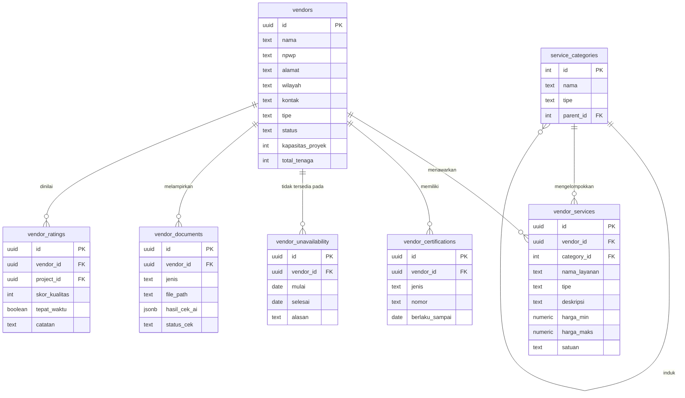

### 9.2 Proyek dan penugasan

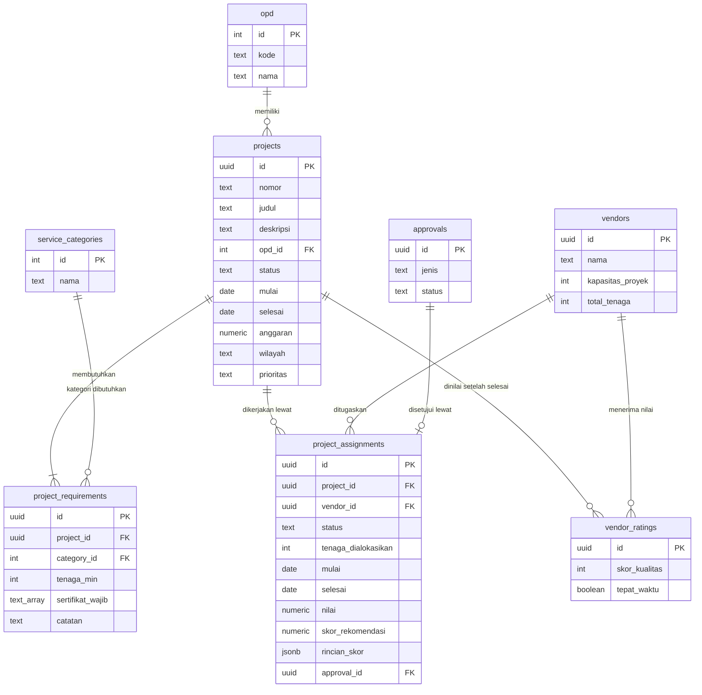

### 9.3 Pengguna, persetujuan, berkas, dan log

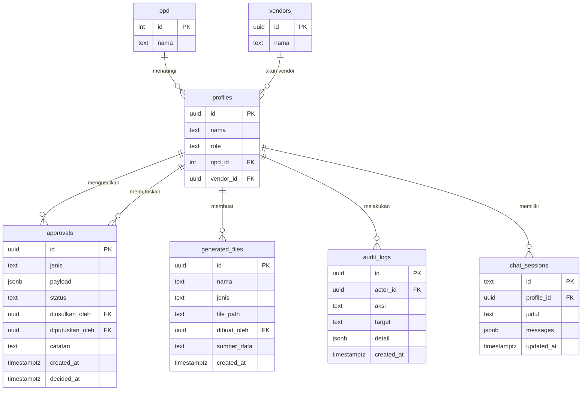

---

## 10. Class diagram dan state diagram

### 10.1 Struktur kode (class diagram)

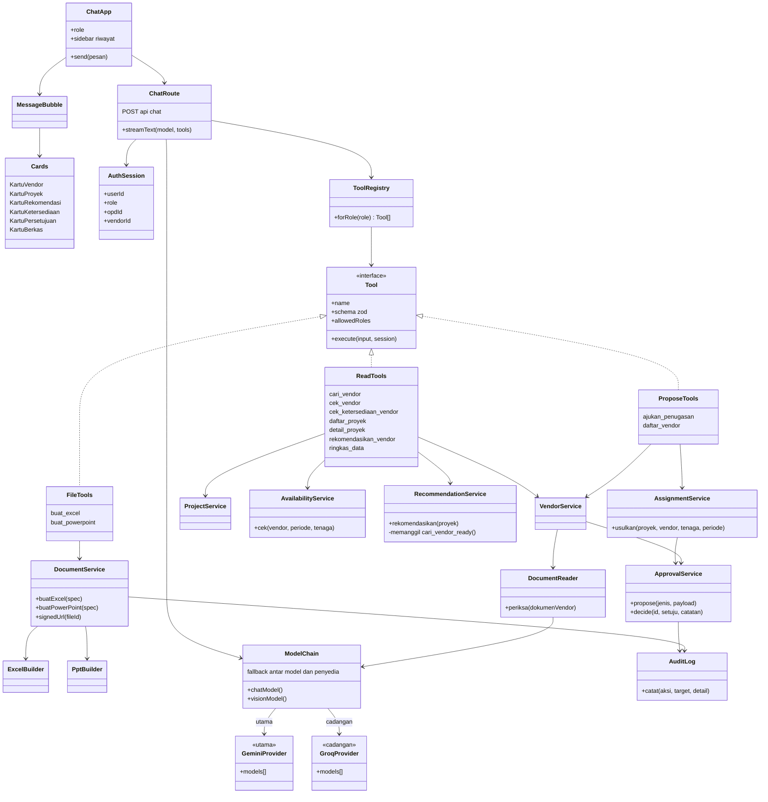

### 10.2 Status proyek (`projects`)

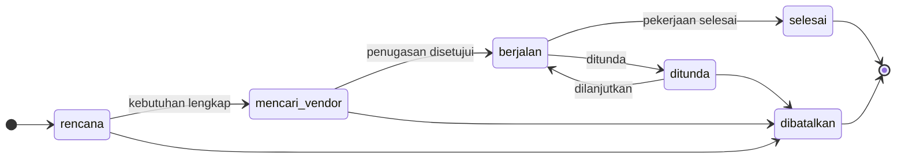

### 10.3 Status penugasan (`project_assignments`)

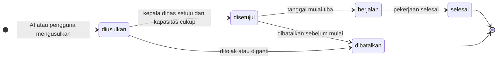

### 10.4 Status vendor (`vendors`)

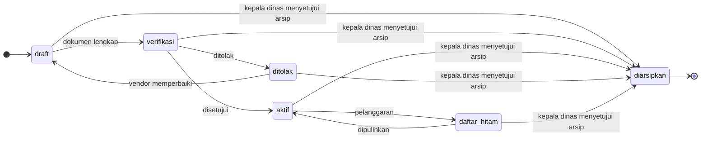

### 10.5 Usulan (`approvals`)

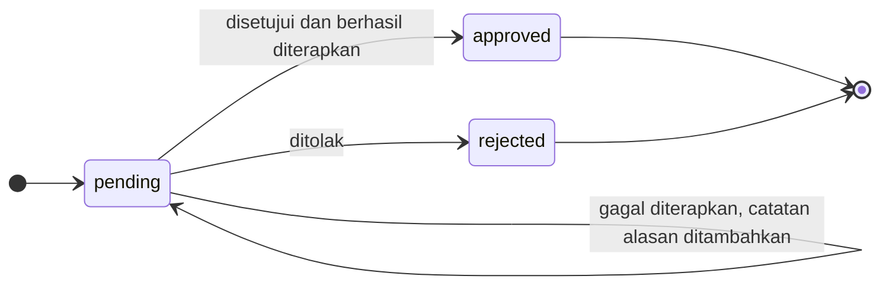

---

## 11. Tech stack dan alat

| Lapisan | Pilihan | Alasan |
|---|---|---|
| Framework | **Next.js 15** (App Router), **React 19**, **TypeScript** | Sama dengan Halvi, banyak kode bisa dipakai ulang |
| Tampilan | **Tailwind CSS v4**, `lucide-react` | Sama dengan Halvi (tema terang, komponen kartu) |
| AI | **Vercel AI SDK v7** (`ai`, `@ai-sdk/react`, `@ai-sdk/google`, `@ai-sdk/groq`) | Streaming, tool calling, loop agen, dua penyedia |
| Model utama | **Google Gemini** (free tier, rantai model cadangan) | Pola sudah jadi di `lib/ai/model.ts` |
| Model cadangan | **Groq** (`@ai-sdk/groq`), hanya jika Gemini habis atau gagal | Peluang kedua saat kuota Gemini habis |
| Validasi | **zod** | Skema input tool dan form |
| Database | **Supabase Postgres** | Sama dengan Halvi, mendukung RLS, fungsi SQL, dan tipe rentang tanggal |
| Autentikasi | **Supabase Auth** (email dan password, akun demo) + `@supabase/ssr` | Peran lewat `profiles`, RLS memakai `auth.uid()` |
| File | **Supabase Storage** (bucket privat) + signed URL | Dokumen vendor dan berkas buatan AI tidak publik |
| Excel | **exceljs** | Format, filter, lebar kolom |
| PowerPoint | **pptxgenjs** | Slide, tabel, dan grafik sederhana dari Node |
| Hosting | **Vercel** | Sama dengan Halvi, deploy otomatis dari GitHub |
| Pencarian | `pg_trgm` | Pencarian vendor dan layanan yang toleran salah ketik |
| Jadwal | `btree_gist` + tipe `daterange` | Pengecekan tabrakan periode |

Alat pengembangan: Claude Code, Chrome untuk uji tampilan, parser `mermaid` untuk memeriksa diagram, Supabase SQL Editor, GitHub.

Hal yang sengaja **tidak** dipakai di demo: vector database dan RAG (data terstruktur cukup dicari dengan SQL), antrean pekerjaan (pembuatan berkas cukup dalam satu request), dan layanan berbayar.

---

## 12. Struktur proyek

Dimulai dari salinan pola Halvi, lalu diganti seperlunya.

```
app/
  (site)/page.tsx            beranda sederhana + tombol masuk   [ganti: landing Halvi]
  login/                     form login Supabase Auth           [baru]
  dashboard/                 ringkasan per peran                [baru]
  chat/                      chat AI                            [pakai ulang]
  vendor/  proyek/  penugasan/   tampilan tabel sederhana       [baru]
  persetujuan/               antrean dan keputusan usulan       [baru]
  berkas/                    daftar Excel dan PPT buatan AI      [baru]
  api/
    chat/                    agen + tool                        [pakai ulang, ubah tool]
    vendor/dokumen/          unggah dan periksa dokumen         [pola dari upload-proof]
    persetujuan/             keputusan usulan                   [baru]
    berkas/[id]/             tautan unduh bertanda tangan        [baru]
components/
  chat/                      sidebar, pesan, composer            [pakai ulang]
  cards/                     KartuVendor, KartuProyek, KartuRekomendasi,
                             KartuKetersediaan, KartuPersetujuan, KartuBerkas   [baru]
  ui/                        loader, smooth scroll, progress     [pakai ulang]
lib/
  ai/
    model.ts                 rantai Gemini lalu Groq             [perluas dari Halvi]
    persona.ts, system-prompt.ts, registry.ts
    tools/                   satu file per tool                  [baru]
  services/                  Vendor, Project, Availability, Recommendation,
                             Assignment, Approval, Document      [baru]
  documents/                 excel-builder.ts, ppt-builder.ts    [baru]
  auth/                      sesi, peran, helper RLS             [baru]
  db/                        klien Supabase (per pengguna dan server)
data/                        01_schema ... 99_reset (SQL)
arsip/                       versi dokumen sebelumnya
```

### Yang dipakai ulang dari Halvi
| Dari Halvi | Dipakai untuk |
|---|---|
| `lib/ai/model.ts` | Rantai model cadangan, **diperluas** agar mendukung Groq setelah Gemini |
| `app/api/chat/route.ts` | Kerangka streaming, ditambah pembacaan peran |
| `lib/ai/tools.ts` (pola) | Tool dibangun per request, kini per peran |
| `components/chat/*`, `components/cards/*` (pola) | Chat dan kartu hasil |
| `app/api/upload-proof` dan `lib/ai/verify-proof.ts` (pola) | Unggah dan baca dokumen vendor |
| `book_seat()` (pola) | Pengecekan ulang kapasitas di `apply_approval()` |
| `app/admin/*` (layout, tabel, filter, kalender) | Halaman tabel dan dashboard |
| `components/ui/*` (struktur komponen) | Loader dan progress. **Warna, font, dan gaya diganti** mengikuti bagian 12A, bukan tampilan Halvi |

### Yang diganti
Landing Haltev, invoice dan QRIS, kartu form kelas, basis pengetahuan Haltev, dan semua tool Halvi.

---

## 12A. Desain dan tampilan

Bagian ini menetapkan **arah visual, warna, font, dan aturan komponen** supaya semua halaman terlihat satu keluarga dan pantas dipakai di lingkungan pemerintah. Isinya langsung bisa dijadikan token di `app/globals.css`.

### 12A.1 Arah desain
Pemkot-AI dipakai pejabat dan staf pengadaan untuk membaca data dan mengambil keputusan. Karena itu tampilannya **formal, tenang, dan padat data**. Halvi dibuat ramah dan santai untuk calon siswa, jadi gayanya sengaja berbeda.

| Aspek | Halvi (demo pertama) | Pemkot-AI (demo kedua) |
|---|---|---|
| Kesan | Ramah, ceria | Formal, tepercaya, tenang |
| Warna | Biru cerah, aksen oranye | Biru tua dan netral, warna lain hanya untuk status |
| Font | Unbounded (judul lebar) + Be Vietnam Pro | IBM Plex Sans + IBM Plex Mono |
| Maskot dan emoji | Ada | **Tidak ada**, diganti logo pemkot |
| Animasi | Banyak (mengetik, memudar, scroll halus) | Minimal (transisi singkat saja) |
| Isi utama | Kartu dan percakapan | **Tabel, kartu data, dan rekomendasi** |
| Bahasa | "Kak", santai | "Bapak/Ibu", baku dan ringkas |

Prinsip:
1. **Tema terang**, latar abu sangat muda, banyak ruang kosong.
2. **Satu warna utama** (biru tua). Warna lain hanya untuk makna status.
3. **Angka harus mudah dibaca:** angka rata, tidak berubah lebar, satuan jelas.
4. **Status tidak hanya warna:** selalu ikon dan kata, supaya aman untuk buta warna dan saat dicetak hitam putih.
5. **Tidak ada hiasan.** Tidak ada gradien mencolok, bayangan tebal, atau ilustrasi.
6. **Aksesibel dulu:** kontras minimal 4,5:1 untuk teks, fokus keyboard terlihat, sasaran sentuh minimal 44 px.

### 12A.2 Warna

| Token | Hex | Dipakai untuk |
|---|---|---|
| `navy` | `#0B2545` | Header dan judul besar |
| `primary` | `#1B4F8C` | Tombol utama, tautan, item menu aktif |
| `primary-soft` | `#EEF3F9` | Panel lembut, baris tabel terpilih, latar badge netral |
| `bg` | `#F6F8FA` | Latar halaman |
| `surface` | `#FFFFFF` | Kartu, tabel, form |
| `line` | `#D8DEE6` | Garis tepi dan pemisah |
| `text` | `#1B2430` | Teks utama |
| `muted` | `#5B6675` | Teks keterangan |
| `gold` | `#E8B94A` | Penanda kecil (peringkat 1, badge), **bukan warna teks** |
| `ok` | `#1E7B4F` | Aktif, disetujui, ready |
| `warn` | `#8A5A00` | Menunggu persetujuan, sertifikat hampir habis |
| `bad` | `#B42318` | Ditolak, daftar hitam, kedaluwarsa |

Kontras yang sudah dihitung (standar aksesibilitas WCAG AA meminta minimal 4,5:1 untuk teks biasa):

| Pasangan | Kontras | Hasil |
|---|---:|---|
| `text` `#1B2430` di putih | 15,7 | Lulus |
| `muted` `#5B6675` di putih | 5,8 | Lulus |
| `muted` `#5B6675` di `bg` `#F6F8FA` | 5,5 | Lulus |
| `primary` `#1B4F8C` di putih (tautan) | 8,3 | Lulus |
| Putih di `primary` (tombol) | 8,3 | Lulus |
| Putih di `navy` (header) | 15,4 | Lulus |
| `ok` `#1E7B4F` di putih | 5,2 | Lulus |
| `warn` `#8A5A00` di putih | 5,9 | Lulus |
| `bad` `#B42318` di putih | 6,6 | Lulus |
| `navy` di `gold` `#E8B94A` | 8,4 | Lulus |
| Emas `#B7791F` di putih sebagai teks | 3,6 | **Gagal**, jadi emas tidak dipakai sebagai warna teks |

Token untuk Tailwind v4 (`app/globals.css`):

```css
@theme {
  --color-navy: #0b2545;
  --color-primary: #1b4f8c;
  --color-primary-soft: #eef3f9;
  --color-bg: #f6f8fa;
  --color-surface: #ffffff;
  --color-line: #d8dee6;
  --color-text: #1b2430;
  --color-muted: #5b6675;
  --color-gold: #e8b94a;
  --color-ok: #1e7b4f;
  --color-warn: #8a5a00;
  --color-bad: #b42318;
}
```

Seluruh warna ada di satu tempat. Jika kota memiliki warna identitas resmi, cukup mengganti `navy`, `primary`, dan `primary-soft` (lalu mengulang uji kontras).

### 12A.3 Font

| Peran | Font | Bobot | Catatan |
|---|---|---|---|
| Semua teks | **IBM Plex Sans** | 400, 500, 600 | Formal dan teknis, angka jelas, gratis lewat Google Fonts |
| Kode, nomor proyek, NPWP | **IBM Plex Mono** | 400, 500 | Karakter yang mirip (0 dan O) mudah dibedakan |
| Alternatif | **Public Sans** | 400, 500, 600 | Lebih hangat, dirancang untuk situs pemerintah |

Pemasangan dengan `next/font` (pelajaran dari Halvi: variabel font menempel di elemen, bukan di `:root`, jadi harus dideklarasikan lewat `@theme inline`):

```ts
// lib/fonts.ts
import { IBM_Plex_Sans, IBM_Plex_Mono } from "next/font/google";

export const sans = IBM_Plex_Sans({
  subsets: ["latin"], weight: ["400", "500", "600"],
  variable: "--font-plex-sans", display: "swap",
});
export const mono = IBM_Plex_Mono({
  subsets: ["latin"], weight: ["400", "500"],
  variable: "--font-plex-mono", display: "swap",
});
```

```css
/* app/globals.css */
@theme inline {
  --font-sans: var(--font-plex-sans), system-ui, sans-serif;
  --font-mono: var(--font-plex-mono), ui-monospace, monospace;
}
body { font-variant-numeric: tabular-nums; }   /* angka rata di tabel */
```

Skala tipografi:

| Elemen | Ukuran / tinggi baris | Bobot |
|---|---|---|
| Judul halaman | 28 / 36 px | 600 |
| Judul bagian | 20 / 28 px | 600 |
| Judul kartu | 16 / 24 px | 600 |
| Isi | 16 / 26 px | 400 |
| Tabel | 14 / 22 px | 400 |
| Keterangan | 13 / 20 px | 400, warna `muted` |
| Kode dan nomor | 14 px | Mono 400 |

Tidak ada teks di bawah 13 px.

### 12A.4 Kerangka halaman

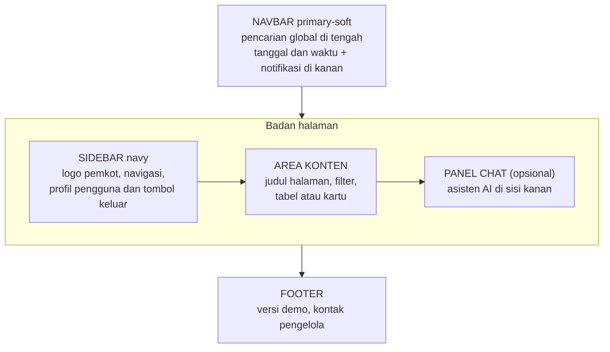

- Desktop dan tablet adalah prioritas. Di layar kecil sidebar menjadi menu yang bisa dibuka, tabel bisa digulir ke samping.
- Item sidebar menyesuaikan peran (vendor hanya melihat Dashboard, Asisten AI, dan data miliknya).
- Navbar berwarna `primary-soft` di sebelah kanan sidebar navy. Pencarian global selebar 24 rem berada di tengah pada desktop dan bergeser ke kiri pada layar sempit agar tidak bertabrakan; tanggal dan waktu WIB serta notifikasi persetujuan berada di kanan.
- Pencarian global hanya menampilkan vendor dan proyek yang dapat diakses peran pengguna. Notifikasi menampilkan persetujuan yang menunggu untuk Kepala Dinas dan keputusan atas usulan sendiri untuk Admin Pengadaan atau PIC Proyek.
- Pada halaman Asisten AI (`/chat`), navbar disembunyikan agar ruang percakapan lebih luas. Sidebar tetap tampil.
- Item sidebar aktif memakai latar `primary` dan teks putih; item lain berteks putih dengan hover `primary`.
- Sidebar utama bisa dibuka tutup menjadi deretan ikon. Panel riwayat Asisten AI bisa dibuka tutup dan digeser lebarnya (200 sampai 440 px). Pilihan ini diingat per browser.
- Halaman **Asisten AI** (`/chat`) memakai lebar penuh dengan daftar riwayat di kiri, seperti Halvi, tetapi dengan gaya formal.

### 12A.5 Komponen

**Tombol**
| Jenis | Gaya |
|---|---|
| Utama | Latar `primary`, teks putih, sudut 6 px |
| Sekunder | Latar putih, garis `line`, teks `primary` |
| Bahaya (Tolak) | Latar putih, garis dan teks `bad` |
| Nonaktif | Abu dengan teks `muted`, kursor tidak boleh diklik |

**Badge status** (selalu ikon dan kata)
| Status | Warna | Ikon | Teks |
|---|---|---|---|
| Aktif, Ready, Disetujui | `ok` | centang lingkaran | "Aktif", "Ready", "Disetujui" |
| Menunggu persetujuan | `warn` | jam | "Menunggu" |
| Sertifikat hampir habis | `warn` | segitiga peringatan | "Hampir habis" |
| Ditolak, Daftar hitam | `bad` | silang lingkaran | "Ditolak", "Daftar hitam" |
| Kedaluwarsa | `bad` | segitiga peringatan | "Kedaluwarsa" |
| Draft, Verifikasi | `primary` di latar `primary-soft` | dokumen | "Draft", "Verifikasi" |
| Diarsipkan, Belum ada riwayat | `muted` | arsip atau info | "Diarsipkan", "Belum ada riwayat" |

**Tabel**
- Header berlatar `primary-soft`, teks 600. Tabel tidak punya scroll vertikal sendiri karena baris dibatasi pagination. Scroll samping hanya muncul jika layar terlalu sempit.
- Baris bergaris tipis `line`, tanpa warna selang-seling yang mencolok. Baris terpilih memakai `primary-soft`.
- Kolom angka rata kanan, `tabular-nums`. Kolom kode memakai font mono.
- Setiap tabel data wajib punya kolom **No** (berlanjut antarhalaman) dan **pagination** dengan keterangan "Menampilkan X sampai Y dari Z". Tabel utama 10 baris per halaman, tabel di halaman detail 5 baris.
- Pencarian dan filter berjalan langsung saat pengguna mengetik atau memilih, lalu kembali ke halaman 1.
- Ada pencarian, filter, dan tombol ekspor (Excel).
- Pada daftar Vendor, tombol Tambah berada di sisi kanan di bawah jumlah vendor; kolom Aksi hanya tampil untuk Admin Pengadaan, dengan tombol Edit dan Arsipkan sejajar horizontal.
- Saat berpindah halaman tabel, tautan pagination menampilkan indikator memuat selama navigasi berlangsung.

**Kartu rekomendasi vendor** (komponen utama demo)

```
┌──────────────────────────────────────────────────────────────┐
│ ① PT Karya Bangun                         Skor 86 / 100       │
│    Jasa konstruksi · Wilayah Kota          [✔ Ready]          │
├──────────────────────────────────────────────────────────────┤
│ Pengalaman  ██████████ 25/25    Kinerja    █████████░ 22/25   │
│ Waktu       █████████░ 13/15    Kapasitas  ███████░░░ 10/15   │
│ Harga       ██████████ 10/10    Wilayah    ██████░░░░  6/10   │
├──────────────────────────────────────────────────────────────┤
│ ✔ Status aktif   ✔ SBU dan K3 berlaku sampai 2027             │
│ ✔ Sisa 2 slot proyek, sisa 18 tenaga                          │
├──────────────────────────────────────────────────────────────┤
│ [ Lihat detail vendor ]                [ Usulkan penugasan ]  │
└──────────────────────────────────────────────────────────────┘
```
- Peringkat 1 diberi penanda `gold` kecil di angka peringkat (latar emas, teks navy).
- Rincian skor ditampilkan sebagai batang sederhana **dengan angka**, tidak hanya batang.
- Vendor tanpa riwayat diberi badge "Belum ada riwayat" di baris yang relevan.

**Kartu persetujuan**
- Judul usulan, pengusul, waktu, ringkasan perubahan (misalnya "Tugaskan PT Karya Bangun ke Renovasi Gedung Dinas, 15 tenaga, 3 bulan").
- Tombol **Setujui** (utama) dan **Tolak** (bahaya, wajib mengisi alasan).
- Setelah keputusan, kartu berubah menjadi badge hasil, tidak hilang (agar ada jejak).
- Jika gagal karena kapasitas, tampil kotak `warn` dengan penjelasan dan saran.

**Kartu dashboard (KPI)**: proyek yang mencari vendor, usulan menunggu, sertifikat hampir habis, vendor aktif. Angka besar (28 px, 600), label kecil di bawahnya, tautan "Lihat daftar".

**Bubble chat**
- Pesan pengguna: latar `primary`, teks putih. Pesan asisten: latar putih, garis `line`, teks `text`.
- Hasil tool tampil sebagai kartu di bawah teks, bukan di dalam bubble.
- Tidak ada avatar maskot. Penanda asisten cukup ikon sederhana dan nama "Asisten Pemkot".

**Kartu berkas**: ikon Excel atau PowerPoint, nama berkas, jumlah baris atau slide, waktu dibuat, tombol Unduh, dan keterangan "tautan berlaku 1 jam".

**Status kosong, memuat, dan gagal**
| Keadaan | Tampilan |
|---|---|
| Kosong | Kalimat singkat dan petunjuk, misalnya "Belum ada vendor yang sesuai. Coba ubah periode atau kategori." |
| Memuat | Bar tipis `gold` di atas halaman dan ikon putar kecil dengan teks "Memuat halaman". Skeleton abu pada tabel atau kartu, bukan animasi besar |
| Gagal | Kotak `bad` ringan dengan pesan jelas dan tombol coba lagi |
| Asisten offline | "Asisten sedang tidak tersedia. Silakan coba lagi sebentar lagi." dengan tombol coba lagi |

### 12A.6 Bahasa dan format Indonesia
- Mata uang: `Rp 1.250.000.000` (titik sebagai pemisah ribuan).
- Rentang harga: `Rp 3.325.000 - Rp 13.300.000`.
- Tanggal: `23 Nov 2026` atau `23 November 2026`. Periode: `1 Jan sampai 31 Mar 2027`.
- Sapaan baku: "Bapak/Ibu". Kalimat pendek, tanpa tanda seru berlebihan, tanpa emoji, tanpa tanda pisah panjang.
- Contoh teks antarmuka: "Belum ada usulan yang menunggu persetujuan." "Vendor ini tidak tersedia pada periode tersebut." "Usulan ditolak. Alasan: kapasitas vendor sudah penuh."
- Keterangan "Seluruh data bersifat fiktif" tampil di footer halaman.

### 12A.7 Aksesibilitas
- Kontras teks minimal 4,5:1 (tabel kontras di 12A.2).
- Fokus keyboard terlihat jelas (garis 2 px `primary` dengan jarak 2 px).
- Semua fungsi bisa dipakai dengan keyboard. Urutan tab masuk akal.
- Dialog konfirmasi memindahkan fokus ke tombol Batal, membatasi fokus di dialog, dan dapat dibatalkan dengan Escape sebelum aksi berjalan.
- Sasaran sentuh minimal 44 px.
- Gambar bermakna diberi teks alternatif. Ikon status selalu disertai kata.
- Menghormati `prefers-reduced-motion`: transisi dimatikan.
- Tabel memakai elemen tabel yang benar (header dan baris), bukan susunan kotak.
- Halaman bisa dicetak: tema terang, tanpa latar gelap, sidebar disembunyikan saat cetak.

### 12A.8 Identitas pemkot
- **Logo:** tempat logo di pojok kiri header (tinggi 32 sampai 40 px). Untuk demo, gunakan logo placeholder netral atau teks "Pemerintah Kota" sampai ada logo resmi.
- **Warna resmi:** jika kota memiliki pedoman identitas visual, ikuti. Ganti token `navy`, `primary`, `primary-soft`, lalu ulangi uji kontras. Hindari warna yang identik dengan partai atau daerah lain karena dapat menimbulkan salah paham.
- **Nama aplikasi:** sementara "Pemkot-AI" atau "Asisten Pengadaan". Keputusan nama ada di pertanyaan terbuka (bagian 19).
- **Tidak ada maskot** pada demo ini. Jika kelak diperlukan, hanya dengan persetujuan.

### 12A.9 Yang dihindari
- Warna oranye menyala, gradien, glow, dan efek kaca.
- Emoji dan ilustrasi lucu.
- Animasi mengetik, memudar, dan scroll halus berlebihan.
- Teks di bawah 13 px atau teks abu terang di atas putih.
- Status yang hanya dibedakan lewat warna.

### 12A.10 Cara memeriksa desain
1. Hitung kontras semua pasangan warna baru (skrip kecil atau alat kontras) sebelum dipakai.
2. Jalankan halaman dengan hanya keyboard.
3. Cetak satu halaman tabel dan satu halaman rekomendasi ke PDF, periksa terbaca hitam putih.
4. Lihat di lebar 1280, 1024, dan 390 px.
5. Cek bahwa tidak ada status yang hanya mengandalkan warna.
6. Bandingkan semua halaman dengan token di 12A.2 (tidak ada warna di luar daftar).

---

## 13. Infrastruktur dan persiapan

### 13.1 Akun yang perlu disiapkan
| Layanan | Untuk apa | Catatan |
|---|---|---|
| GitHub | Repo kode | Repo baru bernama `pemkot-AI`, terpisah dari Halvi |
| Supabase | Database, Auth, Storage | Proyek baru, jangan gabung dengan proyek Halvi |
| Google AI Studio | Kunci API Gemini (utama) | Proyek Google baru supaya kuota gratis terpisah dari Halvi |
| Groq | Kunci API Groq (cadangan) | Opsional, tetapi disarankan untuk hari presentasi |
| Vercel | Hosting | Hubungkan ke repo setelah ada yang berjalan di lokal |

### 13.2 Variabel lingkungan (nama saja)
| Variabel | Fungsi |
|---|---|
| `GOOGLE_GENERATIVE_AI_API_KEY` | Kunci Gemini |
| `GEMINI_MODELS` | Urutan model Gemini (opsional) |
| `GROQ_API_KEY` | Kunci Groq (opsional, tanpa ini tidak ada cadangan) |
| `GROQ_MODELS` | Urutan model Groq (opsional, diverifikasi ke dokumentasi Groq saat implementasi) |
| `SUPABASE_URL` | URL proyek Supabase |
| `NEXT_PUBLIC_SUPABASE_URL` | URL untuk klien browser dan sesi |
| `NEXT_PUBLIC_SUPABASE_PUBLISHABLE_KEY` | Kunci publik untuk sesi login |
| `SUPABASE_SECRET_KEY` | Kunci server (hanya di server, jangan pernah ke browser) |
| `APP_ENV` | `demo` atau `local` |
| `DEMO_QUICK_LOGIN_PASSWORD` | Kata sandi bersama untuk tombol login cepat akun dummy lokal; hanya dibaca server dan jangan dipakai di production |

Aturan rahasia: `.env*` tidak pernah di-commit. Isi kunci tidak dicetak ke log atau ditulis ke dokumen.

### 13.3 Urutan setup
1. Buat repo GitHub baru dan proyek Supabase baru. Catat kunci, isi `.env.local` sendiri.
2. Buat proyek Next.js baru dari pola Halvi, bersihkan konten Haltev.
3. Jalankan SQL `01` sampai `04` berurutan di Supabase SQL Editor.
4. Buat 4 akun demo di Supabase Auth, lalu isi tabel `profiles` dengan peran masing-masing.
5. Untuk login cepat lokal, isi `DEMO_QUICK_LOGIN_PASSWORD` di `.env.local` dengan kata sandi bersama keempat akun dummy. Tombol login cepat muncul saat `npm run dev`, tetapi nonaktif sampai kata sandi ini diatur.
6. Jalankan `npm install` dan `npm run dev`, lalu coba login tiap akun.
7. Hubungkan repo ke Vercel, isi variabel lingkungan, deploy.
8. Uji di versi Vercel, bukan hanya lokal. Pelajaran dari Halvi: file yang dibaca saat runtime harus ikut ter-deploy (cek `outputFileTracingIncludes` dan `.gitignore`).

### 13.4 Akun demo (dibuat saat setup, kata sandi diisi sendiri, tidak ditulis di dokumen)
| Email contoh | Peran |
|---|---|
| `admin.pengadaan@contoh.test` | `admin_pengadaan` |
| `pic.proyek@contoh.test` | `pic_proyek` (terhubung ke satu dinas) |
| `kepala.dinas@contoh.test` | `kepala_dinas` |
| `vendor.demo@contoh.test` | `vendor` (terhubung ke satu vendor contoh) |

---

## 14. Data contoh (seed)

Semua data **fiktif**. Nama usaha dan orang dibuat generik. NPWP dan nomor lain adalah angka acak yang tidak valid. Jumlah di bawah adalah **usulan awal**.

| Data | Jumlah awal | Catatan |
|---|---|---|
| OPD | 6 | Dinas Pendidikan, Kesehatan, PUPR, Kominfo, Sekretariat Daerah, Dinas Kebersihan |
| Kategori layanan | 8 | Konstruksi bangunan, jasa kebersihan, pengadaan alat kesehatan, TI dan perangkat, furnitur, kendaraan, konsultan, jasa keamanan |
| Vendor | 25 | Berbagai status (aktif, verifikasi, ditolak, daftar hitam), wilayah, kapasitas, dan jumlah tenaga |
| Layanan vendor | 60 | Barang dan jasa, kisaran harga wajar |
| Sertifikat | 40 | Sebagian **hampir atau sudah kedaluwarsa** supaya syarat wajib terlihat bekerja |
| Periode tidak tersedia | 6 | Beberapa vendor sibuk atau libur pada periode tertentu |
| Proyek | 15 | Berbagai status: rencana, mencari vendor, berjalan, selesai |
| Kebutuhan proyek | 15 | Kategori, tenaga minimal, sertifikat wajib |
| Penugasan | 20 | Campuran diusulkan, disetujui, berjalan, selesai. Sebagian vendor sengaja **penuh** |
| Penilaian kinerja | 12 | Satu penilaian untuk tiap penugasan yang selesai, termasuk ketepatan waktu |
| Usulan | 3 | Contoh pending, disetujui, ditolak |

Perancangan agar demo terlihat hidup:
- Satu proyek unggulan ("Renovasi Gedung Dinas") dengan **3 vendor ready**, 3 vendor yang gugur dengan alasan berbeda (kapasitas penuh, sertifikat kedaluwarsa, tidak tersedia).
- Dua vendor dengan satu slot kosong, untuk memperagakan dua usulan bersamaan (bagian 6.9).
- Tanggal dibuat **relatif terhadap hari ini**, supaya demo tidak "basi".

Data dihasilkan lewat skrip seed yang ditulis ke `data/04_seed.sql`.

---

## 15. Keamanan, privasi, dan risiko

### 15.1 Keamanan
| Risiko | Penanganan |
|---|---|
| Pengguna mengakses data peran lain | Tool per peran + validasi di service + RLS di database |
| AI mengubah data tanpa izin | Pola usul dan setuju. Tool tulis tidak mengubah data bisnis |
| Vendor melebihi kapasitas karena dua persetujuan bersamaan | Kunci baris vendor dan hitung ulang di `apply_approval()` |
| Prompt injection lewat dokumen vendor | Isi dokumen diperlakukan sebagai data. Hasil bacaan dibatasi ke bidang terstruktur, bukan diteruskan sebagai instruksi |
| Kebocoran berkas | Bucket privat, signed URL kedaluwarsa, cek peran saat membuat tautan |
| Kebocoran kunci | `.env*` di `.gitignore`, kunci server hanya di Vercel, tidak pernah di kode klien |
| Penyalahgunaan chat | Batas panjang pesan, batas permintaan per pengguna, topik dibatasi persona |
| Tidak ada jejak siapa melakukan apa | `audit_logs` untuk semua aksi tulis dan keputusan |

### 15.2 Privasi
- Demo memakai **data fiktif**. Jangan mengunggah data pemerintah asli, dokumen vendor asli, atau data pribadi pegawai ke demo ini.
- Gemini, Groq, Vercel, dan Supabase berada di luar negeri dan syaratnya bisa mengizinkan penggunaan data untuk peningkatan layanan. Itu aman untuk data fiktif, tetapi **tidak** untuk data asli.
- Keterangan bahwa seluruh data fiktif ditampilkan di footer aplikasi.

### 15.3 Risiko khas sistem rekomendasi
| Risiko | Dampak | Penanganan |
|---|---|---|
| **Bias atau ketidakadilan rekomendasi** | Vendor tertentu selalu di atas, vendor baru tidak pernah dapat kesempatan | Skor transparan, rincian per komponen, vendor baru diberi nilai netral dan ditandai, bobot ditetapkan atasan |
| **Data kapasitas tidak akurat** | Rekomendasi salah walau hitungan benar | Vendor memperbarui kapasitas sendiri, tampilkan tanggal pembaruan terakhir, peringatan jika data lama |
| **Kriteria tersembunyi** | Hilang kepercayaan | Semua syarat dan bobot ditulis di dokumen dan ditampilkan di kartu |
| **Pengambilan keputusan otomatis** | Tanggung jawab tidak jelas | Rekomendasi bukan keputusan. Penugasan selalu disetujui manusia dan tercatat |
| **Konflik kepentingan** | Rekomendasi dipengaruhi pihak tertentu | Audit log, pemisahan peran pengusul dan pemutus |

### 15.4 Risiko teknis dan produk
| Risiko | Dampak | Penanganan |
|---|---|---|
| Kuota Gemini gratis habis saat agen multi-langkah | Chat "offline" saat demo | Rantai model Gemini, **Groq sebagai cadangan**, rekaman demo sebagai cadangan terakhir |
| **Perilaku model cadangan berbeda** (tool calling, bahasa Indonesia) | Jawaban atau pemanggilan tool tidak seperti di Gemini | Uji setiap tool dengan model cadangan, deskripsi tool jelas, hasil penting dihitung di database |
| Model memilih tool yang salah | Jawaban tidak sesuai | Deskripsi tool jelas, contoh di persona, uji skenario (bagian 17) |
| Model mengarang angka atau alasan | Kepercayaan hilang | Angka hanya dari hasil tool, alasan hanya dari rincian skor |
| File Excel atau PPT rusak atau jelek | Demo gagal | Uji buka di aplikasi asli, templat tetap, batas jumlah baris |
| Fungsi `cari_vendor_ready()` lambat atau salah | Rekomendasi salah | Indeks periode, uji dengan data kecil yang hasilnya bisa dihitung tangan |
| Lingkup membengkak | Tidak selesai | Pegang daftar "di luar cakupan" (bagian 1) |

### 15.5 Jalan menuju versi resmi (bukan cakupan demo)
Hosting dan data di dalam negeri atau pusat data pemerintah, penyesuaian dengan **UU Pelindungan Data Pribadi** dan kebijakan **SPBE**, integrasi dengan sistem yang sudah ada (misalnya e-katalog, SIRUP), penilaian keamanan oleh tim resmi, penetapan kriteria dan bobot penilaian vendor secara resmi, dan pemilihan model AI yang boleh dipakai instansi. Ini perlu dibahas dengan pihak berwenang sebelum ada rencana produksi.

---

## 16. Rencana kerja bertahap

Urutan kerja yang disarankan. Tidak ada janji waktu, karena bergantung pada data dan keputusan atasan.

```mermaid
flowchart LR
    F0["Fase 0<br/>Setup + login"] --> F1["Fase 1<br/>Vendor + katalog"]
    F1 --> F2["Fase 2<br/>Proyek + penugasan"]
    F2 --> F3["Fase 3<br/>Mesin ready + skor"]
    F3 --> F4["Fase 4<br/>Rekomendasi di chat<br/>+ persetujuan"]
    F4 --> F5["Fase 5<br/>Agen dokumen"]
    F5 --> F6["Fase 6<br/>Peran + RLS"]
    F6 --> F7["Fase 7<br/>Poles + skrip demo"]

    subgraph HariIni["Target satu hari"]
        F0
        F1
        F2
        F3
    end
```

| Fase | Hasil | File utama | Cara uji |
|---|---|---|---|
| 0. Setup dan login | Repo baru, Supabase baru, login jalan, 4 akun demo, `ModelChain` Gemini lalu Groq, token warna dan font (12A) | `lib/auth/*`, `lib/ai/model.ts`, `lib/fonts.ts`, `app/globals.css`, `data/01`, `data/02` | Login tiap akun, peran terbaca, paksa Gemini gagal lalu Groq menjawab |
| 1. Vendor dan katalog | `cari_vendor`, `cek_vendor`, kartu vendor, pendaftaran, edit draft, usulan perubahan dan arsip vendor | `lib/services/vendor.ts`, `lib/ai/tools/cari-vendor.ts`, `app/vendor`, `data/01_schema.sql` | Admin tambah draft, usulkan edit vendor aktif, dan usulkan arsip; data aktif berubah setelah persetujuan |
| 2. Proyek dan penugasan | `daftar_proyek`, `detail_proyek`, tabel proyek dan penugasan, seed proyek | `lib/services/project.ts` | Daftar proyek sesuai peran, detail kebutuhan benar |
| 3. Mesin ready dan skor | `cari_vendor_ready()`, `cek_ketersediaan_vendor`, `rekomendasikan_vendor`, kartu rekomendasi | `data/01_schema.sql`, `lib/services/availability.ts`, `recommendation.ts` | Vendor penuh atau sertifikat kedaluwarsa tidak muncul, skor sama dengan hitungan tangan |
| 4. Rekomendasi di chat dan persetujuan | `ajukan_penugasan`, `apply_approval()`, halaman Persetujuan | `lib/services/assignment.ts`, `approval.ts`, `app/persetujuan` | Dua usulan bersamaan: hanya satu berhasil |
| 5. Agen dokumen | `buat_excel`, `buat_powerpoint`, `ringkas_data`, halaman Berkas | `lib/documents/*`, `lib/services/document.ts` | File terbuka, isi cocok dengan database |
| 6. Peran dan RLS | Registry tool per peran, policy RLS, tampilan per peran | `lib/ai/registry.ts`, `data/03_roles_rls.sql` | Uji hak akses tiap peran (bagian 17.2) |
| 7. Poles dan demo | Dashboard, status kosong dan memuat, responsif, uji kontras dan cetak (12A.10), skrip demo, deploy | `app/dashboard`, README | Latihan demo penuh di Vercel |

Prinsip: setelah setiap fase, aplikasi tetap bisa dijalankan dan didemokan sebagian. Jangan menumpuk semua sampai akhir.

**Target satu hari (usulan):** Fase 0 sampai 3, ditambah persetujuan minimal dari Fase 4. Fase 5 sampai 7 dikerjakan pada hari berikutnya.

---

## 17. Pengujian dan kriteria selesai

Tidak ada suite uji otomatis di Halvi. Demo ini cukup dengan **uji skenario manual** ditambah beberapa pemeriksaan SQL.

### 17.1 Uji skenario per modul
| Modul | Skenario | Hasil yang benar |
|---|---|---|
| Vendor | "Cari vendor jasa kebersihan" | Hanya vendor yang punya layanan kategori itu, status aktif |
| Vendor | "printr laser" atau salah ketik nama | Tetap menemukan vendor atau layanan yang tepat |
| Vendor | Admin menambah vendor dari daftar Vendor | Vendor baru tersimpan sebagai `draft`, belum aktif |
| Vendor | Admin mengedit vendor aktif | Hanya usulan yang dibuat; data tetap sama sampai Kepala Dinas menyetujui |
| Vendor | Admin mengarsipkan vendor tanpa penugasan aktif | Usulan menunggu persetujuan; setelah disetujui, vendor tidak muncul di pencarian biasa dan riwayat tetap ada |
| Vendor | Admin mencoba mengarsipkan vendor dengan penugasan aktif | Ditolak dengan pesan yang jelas; tidak ada perubahan |
| Vendor | Kategori pada usulan perubahan tidak lagi tersedia saat disetujui | Persetujuan gagal dengan pesan yang jelas; data vendor dan katalog lama tetap utuh |
| Vendor | Admin membuka daftar Vendor tanpa filter arsip | Vendor `diarsipkan` tidak tampil; memilih filter Diarsipkan menampilkannya |
| Tabel | Pengguna berpindah halaman melalui pagination | Indikator memuat terlihat selama halaman baru sedang dibuka |
| Proyek | "Proyek yang belum punya vendor" | Hanya proyek tanpa penugasan `disetujui` atau `berjalan` |
| Ready | Rekomendasi untuk proyek unggulan | 3 vendor ready, urutan dan skor sama dengan hitungan tangan |
| Ready | Vendor dengan kapasitas penuh | Tidak muncul, dan alasannya bisa ditampilkan jika ditanya |
| Ready | Sertifikat kedaluwarsa sebelum proyek selesai | Tidak lolos |
| Ready | Periode proyek bertabrakan dengan `vendor_unavailability` | Tidak lolos |
| Ready | Tenaga minimal lebih besar dari sisa tenaga | Tidak lolos |
| Ready | Vendor baru tanpa riwayat | Muncul dengan tanda "belum ada riwayat" dan nilai netral |
| Penugasan | Usul tugaskan vendor | Penugasan `diusulkan`, kapasitas vendor **belum** berkurang |
| Konfirmasi | Batalkan dialog saat menambah, mengedit, mengarsipkan, membuat usulan, menyimpan draft, menghapus percakapan, atau keluar | Tidak ada perubahan; aksi hanya berjalan setelah konfirmasi |
| Konfirmasi | Konfirmasi usulan penugasan atau keputusan persetujuan | Perubahan berjalan satu kali dan kegagalan ditampilkan dengan jelas |
| Penugasan | Kepala dinas menyetujui | Penugasan `disetujui`, kapasitas berkurang, audit log tercatat |
| Pendaftaran | Daftar vendor baru + dokumen | Status `verifikasi`, hasil cek dokumen tampil |
| Dokumen | "Daftar rekomendasi Excel + PPT" | Dua berkas, baris sama dengan hasil `rekomendasikan_vendor` |
| Di luar topik | "Buatkan resep nasi goreng" | Ditolak dengan sopan |

### 17.2 Uji hak akses
| Skenario | Hasil yang benar |
|---|---|
| Admin Pengadaan membuka daftar Vendor | Tombol Tambah berada di kanan; kolom Aksi tampil dan Edit serta Arsipkan sejajar horizontal |
| PIC Proyek atau Kepala Dinas membuka daftar Vendor | Tidak ada kontrol tambah, edit, atau arsip; endpoint pengelolaan tetap menolak peran tersebut |
| Vendor meminta rekomendasi vendor lain | Tidak ada tool, AI menjelaskan tidak punya akses |
| Vendor melihat proyek yang bukan penugasannya | Tidak ditemukan |
| PIC proyek melihat proyek dinas lain | Tidak ditemukan |
| PIC proyek mencoba menyetujui usulan | Tidak bisa, hanya kepala dinas |
| Admin mengubah penugasan lewat chat | Hanya menjadi usulan |
| Panggilan langsung ke tabel lewat klien browser tanpa peran | RLS menolak |

### 17.3 Uji ketahanan dan model
- **Dua usulan bersamaan pada vendor dengan satu slot:** hanya satu yang berhasil, yang kedua gagal dengan `kapasitas_tidak_cukup` (bagian 6.9).
- **Pesan yang sama dikirim dua kali:** tidak ada usulan ganda yang diterapkan dua kali (`apply_approval()` memeriksa status).
- **Paksa Gemini gagal** (misalnya kunci Gemini sengaja dikosongkan di lingkungan uji): jawaban tetap datang lewat Groq, log server mencatat Groq dipakai.
- **Setiap tool diuji dengan model cadangan:** pemanggilan tool benar, skema input terpenuhi, jawaban tetap bahasa Indonesia dan tidak mengarang angka.
- **Semua penyedia gagal:** muncul pesan offline yang ramah dan tombol coba lagi.
- **Buka Excel dan PPT hasil** di aplikasi aslinya.

### 17.4 Pemeriksaan sebelum demo
- Semua skenario bagian 18 dijalankan sekali di versi Vercel.
- Kuota Gemini dan kunci Groq dicek.
- `git status` bersih dan tidak ada rahasia yang ter-commit.

---

## 18. Skrip demo

Perkiraan 8 sampai 10 menit. Semua kalimat di bawah adalah contoh yang bisa diketik langsung.

| Menit | Login sebagai | Aksi | Kalimat contoh |
|---|---|---|---|
| 0 sampai 1 | (slide) | Jelaskan tiga objek (vendor, proyek, penugasan), alur singkat, dan bahwa seluruh datanya fiktif | |
| 1 sampai 2 | `admin_pengadaan` | Cari vendor | "Cari vendor jasa konstruksi yang aktif" |
| | | Cek satu vendor | "Cek PT Karya Bangun" |
| 2 sampai 3 | `admin_pengadaan` | Lihat proyek | "Proyek apa yang belum punya vendor?" |
| | | Detail proyek | "Detail proyek Renovasi Gedung Dinas" |
| 3 sampai 5 | `admin_pengadaan` | **Siapa yang ready** | "Siapa yang ready untuk proyek itu?" (tunjukkan 3 vendor dan rincian skor) |
| | | Tanya alasan | "Kenapa PT Karya Bangun paling atas?" |
| | | Vendor yang gugur | "Kenapa CV Maju Konstruksi tidak masuk?" (kapasitas penuh) |
| 5 sampai 6 | `admin_pengadaan` | Usul penugasan | "Tugaskan PT Karya Bangun ke proyek itu" |
| 6 sampai 7 | `kepala_dinas` | Setujui usulan | Buka kartu atau halaman Persetujuan, setujui, lalu tunjukkan penugasan dan kapasitas vendor berubah |
| 7 sampai 8 | `vendor` | Pendaftaran vendor | "Saya ingin mendaftarkan usaha saya" lalu unggah dokumen contoh |
| | | Hak akses | "Siapa vendor lain yang ready untuk proyek itu?" (ditolak sopan) |
| 8 sampai 9 | `kepala_dinas` | Agen dokumen | "Buatkan daftar rekomendasi vendor untuk proyek itu dalam Excel, lalu ringkasan 5 slide PowerPoint" |
| | | Buka kedua berkas | Unduh dan tunjukkan isi |
| 9 sampai 10 | (slide) | Penutup | Manfaat, batasan demo, langkah berikutnya |

Cadangan jika koneksi atau kuota bermasalah: rekaman layar demo yang sama, tangkapan layar tiap langkah, dan kunci Groq sebagai cadangan model.

---

## 19. Pertanyaan terbuka untuk atasan

Hal yang belum diketahui dan perlu diputuskan sebelum atau selama pengerjaan:

1. **Kriteria dan bobot skor.** Enam komponen dan bobotnya (bagian 5.3) adalah usulan. Siapa yang berwenang menetapkan kriteria resmi?
2. **Syarat wajib resmi.** Sertifikat apa saja yang benar-benar wajib per kategori (misalnya SBU, K3, ISO)?
3. **Sumber data kapasitas.** Apakah vendor mengisi sendiri kapasitas dan tenaga, atau ada yang memverifikasi? Seberapa sering diperbarui?
4. **Arti "ready".** Cukup berdasarkan kapasitas proyek paralel dan sisa tenaga, atau ada faktor lain (jarak, peralatan, kondisi keuangan)?
5. **Dinas atau unit contoh** yang dipakai untuk demo (menentukan kategori layanan dan istilah).
6. **Data yang boleh dipakai.** Hanya data fiktif, atau boleh data asli yang sudah dianonimkan?
7. **Integrasi.** Apakah demo perlu terhubung ke sistem yang ada (e-katalog, SIRUP), atau cukup data contoh?
8. **Persetujuan.** Cukup satu tingkat (kepala dinas), atau perlu dua tingkat?
9. **Kebijakan khusus.** Adakah aturan "tidak boleh menugaskan vendor yang sama berulang", batas nilai kontrak, atau pembatasan lain yang perlu dimasukkan ke syarat wajib?
10. **Format dokumen.** Apakah ada templat Excel atau PowerPoint resmi (kop surat, warna, logo)?
11. **Penyedia AI.** Apakah memakai Groq sebagai cadangan dapat diterima dari sisi kebijakan data, mengingat Groq juga layanan luar negeri (hanya data fiktif)?
12. **Anggaran.** Apakah boleh memakai layanan berbayar (Gemini berbayar, Supabase Pro) untuk hari presentasi?
13. **Hosting.** Apakah demo boleh di Vercel, atau harus di server milik instansi?
14. **Target tampil.** Kapan demo harus siap? (menentukan fase mana yang dipotong)
15. **Nama dan identitas.** Apakah asisten ini diberi nama sendiri? Demo ini sengaja tanpa maskot (bagian 12A).
16. **Warna dan logo resmi.** Apakah kota atau instansi punya pedoman identitas visual (warna, logo, font) yang harus diikuti? Jika ada, token warna di 12A.2 diganti dan kontras dihitung ulang.

---

## 20. Glosarium

| Istilah | Arti sederhana |
|---|---|
| **Vendor / penyedia** | Perusahaan yang menjual barang atau jasa ke pemerintah |
| **Kontraktor** | Vendor yang mengerjakan jasa atau proyek berdasarkan kontrak |
| **Proyek** | Pekerjaan yang dibutuhkan dinas dan perlu dikerjakan vendor |
| **Penugasan** | Penunjukan vendor untuk mengerjakan proyek tertentu pada periode tertentu |
| **Ready** | Vendor yang memenuhi semua syarat wajib pada periode proyek |
| **Kapasitas** | Jumlah proyek paralel dan jumlah tenaga yang sanggup ditangani vendor |
| **Skor kecocokan** | Nilai 0 sampai 100 untuk mengurutkan vendor yang sudah lolos syarat wajib |
| **Syarat wajib** | Syarat yang harus dipenuhi semua. Gagal satu berarti gugur |
| **Sertifikat SBU, K3, ISO** | Bukti kompetensi usaha, keselamatan kerja, atau mutu |
| **Ketepatan waktu** | Persentase proyek yang diselesaikan sesuai jadwal |
| **OPD** | Organisasi Perangkat Daerah, misalnya dinas atau badan |
| **e-katalog** | Katalog elektronik barang dan jasa pemerintah |
| **SIRUP** | Sistem informasi rencana umum pengadaan |
| **SPBE** | Sistem Pemerintahan Berbasis Elektronik |
| **UU PDP** | Undang-Undang Pelindungan Data Pribadi |
| **AI agentic** | AI yang tidak hanya menjawab, tetapi merangkai beberapa langkah dan memakai alat untuk menyelesaikan tugas |
| **Tool (alat)** | Fungsi yang boleh dipanggil AI, misalnya "cek ketersediaan vendor" |
| **Human in the loop** | Manusia memutuskan sebelum aksi penting dijalankan |
| **Penyedia cadangan (fallback)** | Layanan AI kedua yang dipakai bila layanan utama gagal atau kuotanya habis |
| **RLS** | Row Level Security, aturan di database tentang baris mana yang boleh dilihat atau diubah siapa |
| **Atomik** | Operasi yang selesai seluruhnya atau tidak sama sekali |
| **Audit log** | Catatan siapa melakukan apa dan kapan |
| **Signed URL** | Tautan unduh sementara yang kedaluwarsa |
| **Prompt injection** | Upaya menyisipkan perintah palsu lewat teks atau dokumen agar AI menurutinya |
| **Seed** | Data contoh awal yang diisikan ke database |
| **ERD** | Diagram yang menunjukkan tabel database dan hubungannya |
